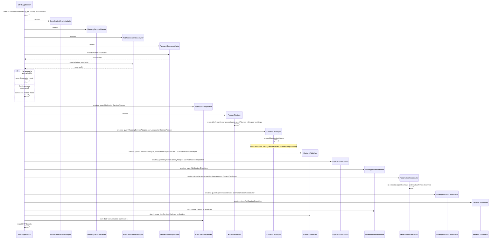
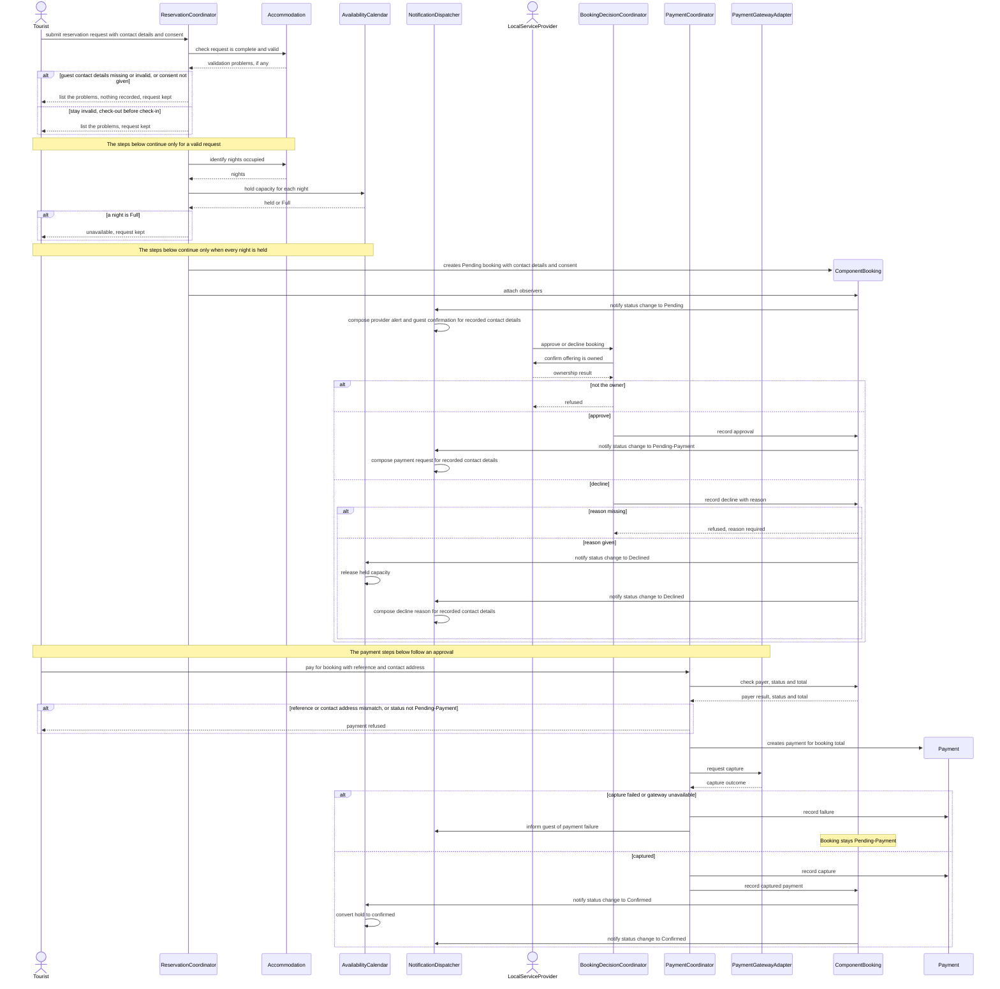
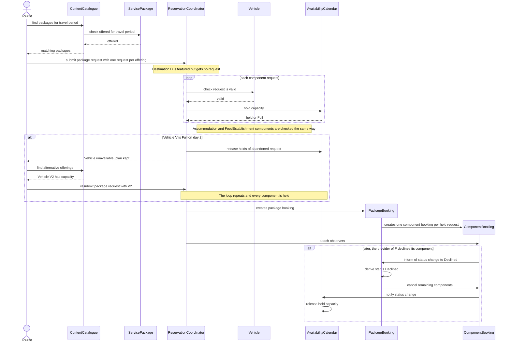
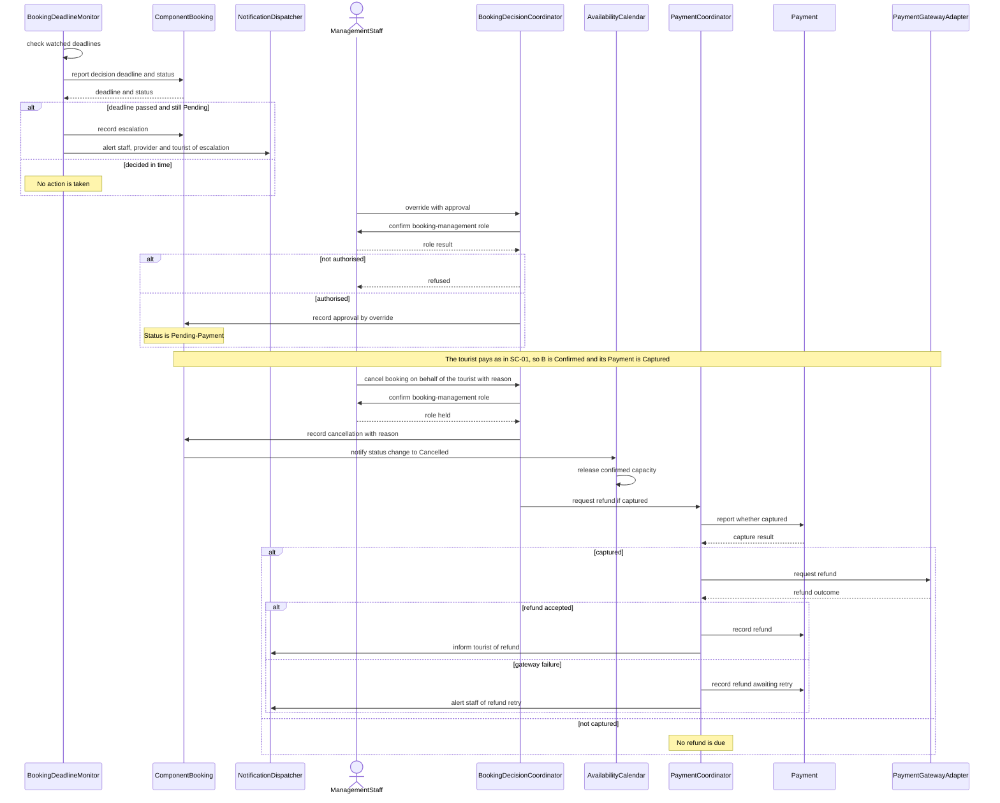
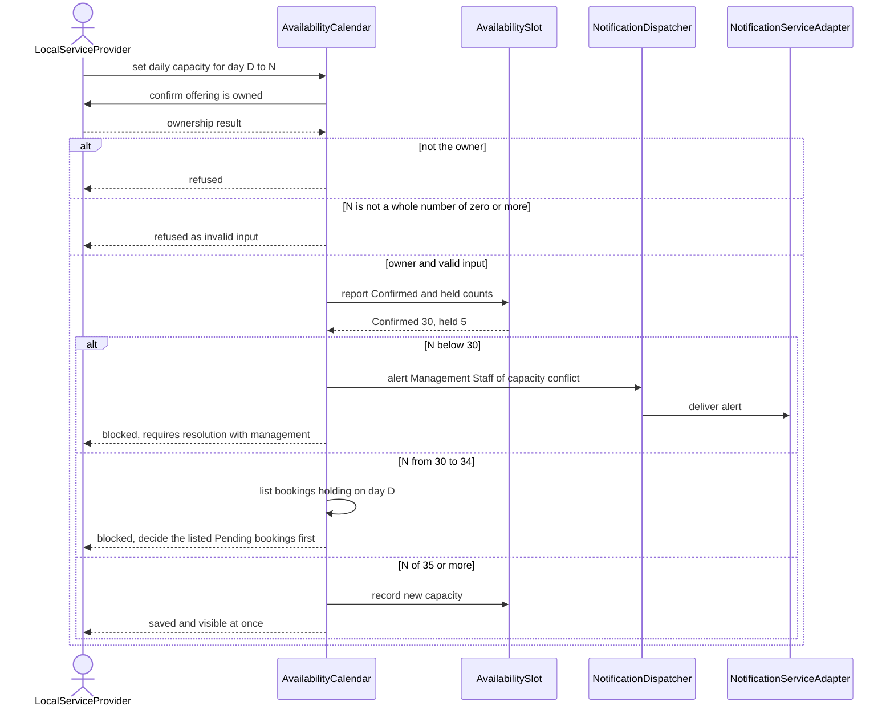
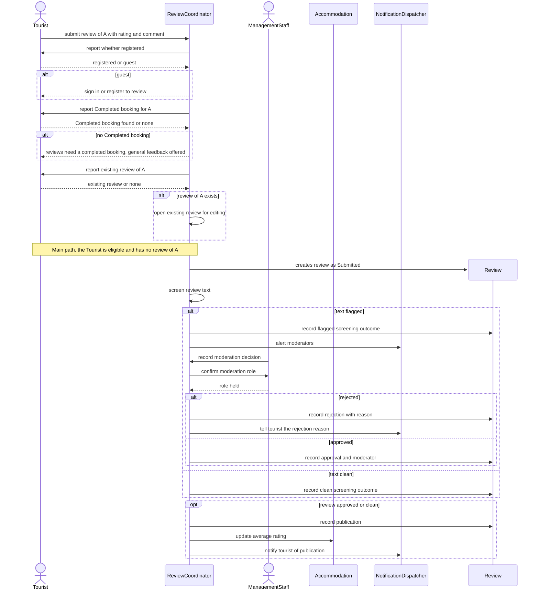

# Object Design Document: Sarawak Tourism Promotion System (STPS)

**Unit:** SWE30003 Software Architectures and Design
**Assessment:** Assignment 2, Initial Object-Oriented Design
**Group:** Group 16, tutorial group 1
**Lecturer:** Prof Ts Dr Lau Bee Theng
**Date:** October 2026

**Authors (Group 16):**
1. Jarren Pin Yu TAN, 104389729
2. Dylan Ding Qian Jong, 102780922
3. Edwin Zheng Quan KONG, 102780074
4. Yon LIM, 105811100
5. Chester Chee Shiu VONG, 102788243

---

## Document Control

| Version | Date | Status | Authors | Change summary |
|---|---|---|---|---|
| 1.0 | October 2026 | Draft for review | All members of Group 16 | First complete object design, written from the team's approved design blueprint |

*Table 1: Document revision history*

---

## Table of Contents

1. Executive Summary
2. Introduction
   - 2.1 Purpose
   - 2.2 Scope
   - 2.3 Audience
   - 2.4 Outlook of the Solution
   - 2.5 Definitions
3. Assumptions
   - 3.1 Design Assumptions
   - 3.2 Approved Design Decisions
   - 3.3 Open Questions
4. Problem Analysis
   - 4.1 Approach
   - 4.2 Analysis
   - 4.3 Simplifications
   - 4.4 Corrections to Assignment 1 References
5. Candidate Classes
   - 5.1 Candidate Class List
   - 5.2 Class Diagram
   - 5.3 Justification of Chosen Classes
   - 5.4 Discarded Classes
6. CRC Cards
7. Design Quality
   - 7.1 Responsibility Coverage
   - 7.2 Responsibility Distribution
   - 7.3 Design Heuristics
   - 7.4 Design Patterns
8. Bootstrap Process
   - 8.1 Bootstrap Sequence Diagram
   - 8.2 Creation Order
   - 8.3 Dependency Checks
9. Verification
   - 9.1 Scenario Overview
   - 9.2 SC-01 Guest Accommodation Reservation through Approval and Payment
   - 9.3 SC-02 Package Booking with an Unavailable Component, then a Component Decline
   - 9.4 SC-03 SLA Expiry Escalated to Management Staff, Override, then Cancellation with Refund
   - 9.5 SC-04 Provider Capacity Reduction Blocked by Confirmed Bookings
   - 9.6 SC-05 Review Submission through Screening and Moderation
10. References

- Appendix A: Assignment 1 Software Requirements Specification
- Appendix B: A1 Task to Class Traceability

---

## 1 Executive Summary

The Sarawak Tourism Promotion System (STPS) is a platform that promotes tourism in Sarawak. Tourists use it to discover local tourism information and to reserve accommodation, transport, dining and service packages. Local Service Providers use it to manage the availability of their own listings and to decide on bookings for them. Management Staff use it to manage promotional content, oversee bookings and moderate reviews. Our Assignment 1 Software Requirements Specification (Group 16 2026), attached as Appendix A, defines these needs as ten user tasks plus product-level and quality requirements.

This document gives the initial object-oriented design that meets those requirements. We used Responsibility-Driven Design (Wirfs-Brock & McKean 2003): we extracted candidate objects and their responsibilities from the A1 tasks, assigned each responsibility to the class that holds the information it needs, and recorded the result on CRC cards (Beck & Cunningham 1989). The design has 36 classes in four kinds: domain entities, control classes, data structure definitions and adapters to the four external services. It applies four Gang of Four patterns, Composite, Observer, Adapter and Template Method (Gamma et al. 1994), and ten named design heuristics (Larman 2004; Riel 1996). No class directs other classes the way a central "manager" or "menu" class would.

The document contains:
- the introduction and design outlook (Section 2);
- the assumptions, approved decisions and open questions (Section 3);
- the problem analysis, simplifications and corrections to A1 references (Section 4);
- the candidate classes, the class diagram and the justification (Section 5);
- one CRC card per class (Section 6);
- the design-quality evidence: coverage, responsibility distribution, heuristics and patterns (Section 7);
- the start-up (bootstrap) process (Section 8);
- five verification scenarios with sequence diagrams (Section 9);
- the references (Section 10) and two appendices.

The design is the baseline for the detailed design in Assignment 3 (A3). The items deliberately left to A3 are listed in Section 4.3 and Section 3.3.

## 2 Introduction

### 2.1 Purpose

This document records the initial object design of STPS. It identifies the classes that make up the solution, the responsibilities and collaborators of each class, the patterns and heuristics that shaped them, how the system starts up, and how the design carries out typical tasks. It follows the brief for Assignment 2: it contains no method names, signatures, attributes or fields, because those decisions belong to detailed design.

### 2.2 Scope

The design covers every user task in A1 §3.3 and A1 §4:

- Task 1 Discover Local Tourism Information
- Task 2 Reserve Accommodation
- Task 3 Reserve Transportation
- Task 4 Reserve Food & Dining
- Task 5 Book Services
- Task 6 Submit Review & Feedback
- Task 7 Manage Promotional Content & Listing
- Task 8 Manage Bookings Availability
- Task 9 Manage Own Listing Availability
- Task 10 Decide on Own-Listing Bookings

It also covers the A1 §8.1 product requirements that have no task of their own: payment (PR-10), tourist accounts (PR-12), role-based access (PR-13) and the booking lifecycle (PR-15). The four external systems named in A1 §2.3 (Payment Gateway Provider, Notification Service, Mapping/Geolocation Service and Translation/Localization Service) are outside STPS. The design reaches each one only through an adapter class.

The design does not include user-interface classes, persistence design or concurrency mechanisms. Section 4.3 lists these simplifications and their consequences.

### 2.3 Audience

The primary reader is a technical reader on the client's side who will review this design and then carry it into detailed design and implementation in A3. We assume the reader knows UML class and sequence diagrams and the basic idea of CRC cards. Section 2.5 defines the design terms and STPS terms we use. Markers of SWE30003 are a secondary audience.

### 2.4 Outlook of the Solution

STPS is designed as a set of cooperating objects, each with a small, clear set of responsibilities. The classes fall into five groups:

- **Account objects.** UserAccount, with its subclasses Tourist, LocalServiceProvider and ManagementStaff, knows who a user is and what they may do. Because user-interface classes are deferred (SI-01), each account object also acts as its person's proxy and starts that person's requests. A Tourist can be in guest mode or registered mode, so a visitor can book without creating an account, as A1 Task 4 and Task 5 allow.
- **Content objects.** ContentItem and its subclasses hold the bilingual, publishable content of STPS. BookableOffering and its three subclasses (Accommodation, Vehicle and FoodEstablishment) are the listings a Tourist can reserve.
- **Booking objects.** Booking, ComponentBooking and PackageBooking record reservations. AvailabilityCalendar and AvailabilitySlot keep daily capacity so that STPS never overbooks (A1 §7.4).
- **Control objects.** One coordinator per group of tasks (ReservationCoordinator, BookingDecisionCoordinator, PaymentCoordinator, ReviewCoordinator, ContentPublisher), plus ContentCatalogue for finding content and two observers that react to booking changes and the passage of time (NotificationDispatcher, BookingDeadlineMonitor). No coordinator directs another coordinator.
- **Adapters.** PaymentGatewayAdapter, NotificationServiceAdapter, MappingServiceAdapter and LocalizationServiceAdapter keep third-party protocols out of the domain classes.

Every booking status change is broadcast through the Observer pattern to the objects that must react: the calendar updates capacity, the dispatcher notifies the parties and the deadline monitor starts or stops its timers. STPSApplication is the single, defined entry point. It only creates and wires objects at start-up and then steps aside.

### 2.5 Definitions

| Term | Meaning in this document |
|---|---|
| A1, A2, A3 | Assignment 1 (our SRS, Appendix A), Assignment 2 (this document) and Assignment 3 (detailed design). |
| A1 §N | Section N of the A1 SRS. "Section N" without "A1" always means a section of this document. |
| Task N | One of the ten A1 user tasks listed in Section 2.2. |
| PR-N, DR-N | Product-level and design-level requirements in A1 §8.1 and A1 §8.2. |
| Class Rn | Responsibility number n on the CRC card of that class. Responsibilities are numbered R1, R2 and so on in table-row order (Section 6). |
| Adapter | A class that translates STPS requests into the protocol of one external system (Section 7.4). |
| Bootstrap | The start-up sequence that creates the long-lived objects of STPS (Section 8). |
| CRC card | Class-Responsibility-Collaborator card (Beck & Cunningham 1989). |
| Collaborator | A class whose help a class needs to carry out one responsibility. |
| Data structure definition | A record-like class that only holds data. It is marked «datatype» in the class diagram. |
| Degraded mode | Start-up state when an external service is unreachable: payments are refused and notifications are queued for retry (AS-18). |
| GoF | "Gang of Four", the authors of the design-pattern catalogue (Gamma et al. 1994). |
| GRASP | General Responsibility Assignment Software Patterns (Larman 2004). |
| Guest mode | A Tourist object that represents an unregistered visitor for the length of a session (AS-01). |
| Hold | Capacity reserved for a booking that is not yet Confirmed (AS-04). |
| MYR | Malaysian ringgit, the currency of record (AS-15). |
| PDPA | Malaysia's Personal Data Protection Act, referred to in A1 §7.2. |
| SLA | Service-level agreement. Here, the 48-hour window in which a provider must decide on a booking (AS-08). |
| Booking statuses | Pending, Pending-Payment, Confirmed, Completed, Declined and Cancelled (PR-15; Booking R2). |
| Content statuses | Draft, Scheduled, Published, Unpublished and Archived (AS-14). |

*Table 2: Definitions and abbreviations*

## 3 Assumptions

### 3.1 Design Assumptions

Each assumption is one testable statement. The last column shows the classes, responsibilities or scenarios it shapes.

| ID | Assumption | Rationale and source | Traces to |
|---|---|---|---|
| AS-01 | A Tourist can book in guest or registered mode. A guest is a temporary, unregistered Tourist object created by AccountRegistry for the visitor's session. Every booking records the contact details and consent from its ReservationRequest, and these are required and validated when the Tourist is a guest. Reviews still require a signed-in registered Tourist (Task 6), and bookmarking still prompts a guest to register without losing context (Task 1 subtask 3). | Task 4 and Task 5 preconditions ("guest or registered mode"); A1 §3.2 Actors. Recording contact details on the booking lets notifications, payment and decisions reach a guest without a stored account. | Tourist R3, R7; ReservationRequest R2; Booking R1, R8; AccountRegistry R1, R6; ReviewCoordinator R1; SC-01 |
| AS-02 | Destination is informational content, not a bookable offering. It can feature in a ServicePackage itinerary but never produces a ComponentBooking. | The A1 §7 introduction defines Bookable Offering as Accommodation, Vehicle or Food Establishment. The Task 5 postcondition creates component bookings only for those three. This resolves the A1 §6 subtype error. | Destination, ServicePackage |
| AS-03 | Capacity is a whole-number daily value per offering per date, in the offering's own unit: rooms for Accommodation, seats for Vehicle, covers for FoodEstablishment. | Task 9 subtask 1 ("daily capacity"). | AvailabilitySlot |
| AS-04 | Capacity is held from Pending until the booking is Confirmed (the hold is converted to confirmed) or Declined or Cancelled (the hold is released). Remaining capacity = capacity − held − confirmed. | A1 §5 workflows 2 to 5 ("hold capacity"); A1 §7.4; Task 4 subtask 2 (capacity held by packages). | AvailabilityCalendar R2 to R4 |
| AS-05 | A provider capacity change is refused if it is below that day's Confirmed count (management resolution required) or below Confirmed plus held (the provider must decide Pending bookings first). | Task 9 subtask 1. The extra held rule enforces A1 §7.4 (never overbook). Approved decision AD-06. | AvailabilityCalendar R5; SC-04 |
| AS-06 | Approval by the provider, or by a staff override, moves a booking to Pending-Payment and keeps its hold. The booking becomes Confirmed only when payment is captured. | PR-15; Task 4 postcondition. Resolves the Task 10 variant wording "approval confirms". | ComponentBooking R3; SC-01 |
| AS-07 | A Pending-Payment booking that is unpaid 24 hours after approval is Cancelled and its hold released. No refund is due. This applies to guests too. | A1 is silent. Without this rule a hold could last for ever. Approved decision AD-03. | BookingDeadlineMonitor R5 |
| AS-08 | The 48-hour SLA runs from the creation of each ComponentBooking. Escalation is a flag on a Pending booking, not a status. | Task 8 trigger; Task 10 subtask 2; PR-15 has no "Escalated" state. | ComponentBooking R2; SC-03 |
| AS-09 | Package bookings are all-or-nothing. Every component must be held at creation. If any component is Declined, the PackageBooking is Declined, its other components are Cancelled and all holds are released. The tourist's plan is kept so it can be resubmitted. | A1 §5 workflow 5 ("All components approved? No → release held capacity"); Task 5 variant 4a. Approved decision AD-05. | PackageBooking R3, R4; SC-02 |
| AS-10 | There is one Payment per payable booking: a standalone ComponentBooking or a whole PackageBooking. | Task 5 trigger ("as one Booking"). | Booking, Payment |
| AS-11 | Management Staff roles (Content Officer, Data/System Admin and booking management) are permission sets held by one ManagementStaff account, and one person may hold several. | A1 §3.2 Actors. The Task 8 precondition names a third role, "booking-management permission". Resolves the A1 §6 association drawn instead of a generalisation. | ManagementStaff; UserAccount R2, R3; D-03 |
| AS-12 | A staff override approval stands in for the provider's approval. After it, the provider cannot decline unilaterally: a provider that cannot honour the booking asks Management Staff to cancel it, with a refund if payment was captured. | Task 8 subtask 3 ("Finalize a component Booking that its LSP did not approve … payment already made"); Task 9 "explicit resolution with management". Approved decision AD-07. | SC-03 |
| AS-13 | A registered Tourist may write at most one Review per BookableOffering. One Tourist writes zero or more Reviews, and each Review is about exactly one BookableOffering. | Task 6 variant 2a. Resolves the conflict between the A1 §6 table ("Many-to-Many") and the A1 §6 diagram. | Review; Tourist R4 |
| AS-14 | Content statuses are Draft, Scheduled, Published, Unpublished and Archived. An incomplete item can be saved only as Draft. Items unpublish automatically at their end date. | Task 7 subtasks 4 to 7, variants 4a and 6a. | ContentItem R2, R3; ContentPublisher R7 |
| AS-15 | Prices are held in MYR. The Translation/Localization Service supplies indicative exchange rates, and when it is unreachable prices show in MYR only. | A1 §7.3; Task 5 subtask 2. See OQ-01 in Section 3.3. | LocalizationServiceAdapter R2 |
| AS-16 | Card details are entered only on the Payment Gateway Provider's own page. STPS keeps only the transaction reference and the payment status. | A1 §2.2; PR-10; Task 5 subtask 3. | PaymentGatewayAdapter R1 |
| AS-17 | A Confirmed booking becomes Completed automatically after its last service day has passed. | Task 6 subtask 3 needs a completed booking, and A1 names no trigger. Approved decision AD-04. | BookingDeadlineMonitor R6 |
| AS-18 | If an external service is unreachable at start-up, STPS still starts in degraded mode: payments are refused and notifications are queued for retry. | Pay-after-approval means reservations can proceed without the gateway; A1 §7.4 availability. | STPSApplication R2 |
| AS-19 | Each AvailabilityCalendar processes hold requests for its offering one at a time. The locking mechanism is decided in A3. | A1 §7.4 (concurrent requests). | AvailabilityCalendar R3 |
| AS-20 | Withdrawing a listing that has Pending or Confirmed bookings is warned about, not blocked. Management Staff resolve the affected bookings under Task 8. | Task 7 variant 7a. A1 routes this to Task 10, but staff, not providers, resolve it, so the design routes it to Task 8. | ContentPublisher R6 |
| AS-21 | A guest who returns later, to pay or to view a booking, is identified by the booking reference and the contact address recorded on the booking. If the guest registers, AccountRegistry converts the guest Tourist into a registered one and keeps its bookings. | Pay-after-approval means a guest must come back after the 48-hour decision. Task 1 subtask 3 asks for registration "without losing the current browsing context". | AccountRegistry R1, R2; Booking R8; PaymentCoordinator R1 |

*Table 3: Design assumptions*

### 3.2 Approved Design Decisions

The team settled the following questions during design. They are binding on this document.

| ID | Decision | Where recorded |
|---|---|---|
| AD-01 | The class model of 36 classes is approved without trims. | Section 5.1 |
| AD-02 | Guests can book, as A1 Task 4 and Task 5 preconditions state. | AS-01, AS-21 |
| AD-03 | There is a 24-hour payment deadline after approval. | AS-07 |
| AD-04 | A booking completes automatically after its last service day. | AS-17 |
| AD-05 | A package is declined as a whole when any component is declined, matching the A1 §5 workflow for Task 5. | AS-09 |
| AD-06 | A capacity reduction is blocked below Confirmed plus held. | AS-05 |
| AD-07 | A staff override stands in for provider approval. | AS-12 |
| AD-08 | The CRC superclass placeholder is "None"; "—" is used only in collaborator cells. | Section 6 |
| AD-09 | A message that reaches an inherited responsibility is cited "(inherited from X)". | Section 9 |
| AD-10 | This document includes a short note correcting stale A1 references. | Section 4.4 |

*Table 4: Approved design decisions*

### 3.3 Open Questions

These questions remain open. The design uses the current decision until A3 confirms or replaces it.

| ID | Question | Current decision |
|---|---|---|
| OQ-01 | What is the source of indicative exchange rates? | The Translation/Localization Service (AS-15). |
| OQ-02 | Should boundary classes (TouristPortal, ProviderConsole, StaffConsole) be added? This would add 3 cards and remove the coupling flag on Tourist (Section 7.2). | Deferred to A3 (SI-01). |
| OQ-03 | How long are a guest Tourist and its contact details kept after its bookings finish (PDPA retention)? | Decided with the A3 PDPA design (SI-12). |

*Table 5: Open questions and current decisions*

## 4 Problem Analysis

### 4.1 Approach

We followed the responsibility-driven approach of Wirfs-Brock and McKean (2003), working from the requirements that our A1 SRS validated (Sommerville 2016). The steps were:

1. **Noun extraction.** We read A1 §3.2 (domain entities and actors), A1 §6 (data model), the ten task descriptions in A1 §4 and the product requirements in A1 §8.1, and listed every candidate noun with its source (Table 6).
2. **Verb extraction.** We listed the verb phrases that describe system behaviour and gave each one an owning class responsibility (Table 7).
3. **Filtering.** We kept a candidate as a class only if it had behaviour or knowledge that no other class could own cleanly. Merged and discarded candidates are listed with reasons in Section 5.4.
4. **Responsibility assignment.** We assigned each responsibility to the class with the information it needs (Information Expert) and gave creation to the class that contains or initialises the new object (Creator) (Larman 2004).
5. **Checking.** We checked coverage of every A1 task (Section 7.1), the spread of responsibilities (Section 7.2) and five end-to-end scenarios (Section 9).

### 4.2 Analysis

#### 4.2.1 Noun Analysis

The "Outcome" column shows the class (CL-nn, Table 10), discarded candidate (D-nn, Table 12), assumption (AS-nn, Table 3), simplification (SI-nn, Table 9) or responsibility that each noun became.

| ID | Candidate noun | A1 source | Outcome |
|---|---|---|---|
| N-01 | Tourist | A1 §3.2; Tasks 1–6 | CL-04 Tourist |
| N-02 | Guest | A1 §3.2 Actors ("browse as guest"); Task 1 subtask 3; Tasks 4–5 preconditions | Tourist in guest mode (AS-01, D-19) |
| N-03 | Registered profile, tourist account | A1 §3.2 Actors; PR-12 | CL-03 UserAccount, CL-02 AccountRegistry |
| N-04 | Management Staff | A1 §3.2, §6 | CL-06 ManagementStaff |
| N-05 | Content Officer, Data/System Admin | A1 §3.2 Actors | Roles held by ManagementStaff (D-03) |
| N-06 | App Management Staff, Service Management Staff | A1 §6 | Discarded (D-02) |
| N-07 | User Role and Access | A1 §6 | Merged into UserAccount (D-04) |
| N-08 | Local Service Provider | A1 §3.2; Tasks 9, 10 | CL-05 LocalServiceProvider |
| N-09 | Services (bookable offering) | A1 §6; A1 §7 introduction | CL-08 BookableOffering (D-01) |
| N-10 | Accommodation | A1 §6; Task 2 | CL-09 Accommodation |
| N-11 | Vehicle, Transportation | A1 §6; Task 3 | CL-10 Vehicle |
| N-12 | Food Establishment | A1 §6; Task 4 | CL-11 FoodEstablishment |
| N-13 | Destination | A1 §6; Task 1; Task 5 trigger | CL-12 Destination (AS-02) |
| N-14 | Local Article Info | A1 §6; Task 1 subtask 2 | CL-13 LocalArticleInfo |
| N-15 | Listing, promotional content | Task 7 | CL-07 ContentItem |
| N-16 | Package, Service Package, Travel Package | Task 5; PR-09 | CL-14 ServicePackage |
| N-17 | Itinerary | Task 5 trigger | PackageBooking without a ServicePackage (D-08) |
| N-18 | Booking | A1 §6 | CL-18 Booking |
| N-19 | Package Booking, component Booking | Task 5 postcondition; Task 8 subtasks 1–3 | CL-20 PackageBooking, CL-19 ComponentBooking |
| N-20 | Booking status | PR-15 | Booking responsibility (D-06) |
| N-21 | Availability calendar | Task 8 subtask 4 | CL-22 AvailabilityCalendar |
| N-22 | Availability slot, daily capacity | Task 9 subtask 1; A1 §7.4 | CL-23 AvailabilitySlot |
| N-23 | Guest, contact, reservation and journey details | Task 2 subtask 2; Task 3; Task 4 subtask 3; Task 5 subtask 3 | CL-17 ReservationRequest |
| N-24 | Add-on (dietary) | A1 §5 workflow 4 | SI-05 |
| N-25 | Payment | A1 §6; PR-10 | CL-28 Payment |
| N-26 | Refund | Task 8 subtasks 3, 5 | Merged into Payment (D-09) |
| N-27 | Payment Gateway Provider | A1 §2.3, §3.2 | CL-33 PaymentGatewayAdapter |
| N-28 | Notification, Notification Service | A1 §2.3; Task 10 subtask 3 | CL-27 NotificationDispatcher, CL-34 NotificationServiceAdapter |
| N-29 | Mapping/Geolocation Service | A1 §2.3; Task 1 variant 1a | CL-35 MappingServiceAdapter |
| N-30 | Translation/Localization Service | A1 §2.3; Task 7 subtask 3 | CL-36 LocalizationServiceAdapter |
| N-31 | SLA window (48 hours) | Task 8 trigger; Task 10 subtask 2 | CL-26 BookingDeadlineMonitor; ComponentBooking R2 |
| N-32 | Review | A1 §6; Task 6 | CL-31 Review |
| N-33 | General feedback | Task 6 subtask 1, variant 3a | CL-30 Feedback |
| N-34 | Average rating | Task 6 subtask 6 | BookableOffering R5 |
| N-35 | Bookmark | Task 1 subtask 3 | Tourist R3 (D-11) |
| N-36 | Category | Task 1 subtask 1; PR-03 | ContentItem R1 (a value) |
| N-37 | Decline reason | Task 10 subtask 3 | ComponentBooking R4 |
| N-38 | Daily slot-utilisation summary | Task 10 subtask 3 | NotificationDispatcher R4 |
| N-39 | MYR price, indicative conversion | Task 5 subtask 2; A1 §7.3 | BookableOffering R2; LocalizationServiceAdapter R2 (D-12) |
| N-40 | PDPA data-subject request, consent | A1 §3.2 Actors; A1 §7.2 | AccountRegistry R5; Tourist R5; ReservationRequest R2 (D-13) |
| N-41 | Data repository | A1 §2.2 | SI-02 (D-14) |
| N-42 | Audit "who and when" | Task 7 subtask 6; A1 §7.2 | ContentItem R4; Payment R3, R4 |

*Table 6: Noun extraction from the A1 SRS*

#### 4.2.2 Verb Analysis

| ID | Verb phrase | A1 source | Owning responsibility |
|---|---|---|---|
| V-01 | search by category or location | Task 1 subtask 1, variant 1a | ContentCatalogue R2 |
| V-02 | suggest related categories or alternatives | Task 1 subtask 1; Task 2 variant 1a | ContentCatalogue R3, R5 |
| V-03 | hide expired content | Task 1 subtask 2 | ContentItem R5 |
| V-04 | validate booking and contact details | Task 2 variant 2a; Task 4 subtasks 1, 3; Task 5 subtask 3 | BookableOffering R4; ReservationCoordinator R1 |
| V-05 | check availability, hold capacity | Tasks 2–5; A1 §5 workflows 2–5 | AvailabilityCalendar R2, R3 |
| V-06 | record reservation | Task 2 subtask 2; Task 3 subtask 3 | ReservationCoordinator R3, R4 |
| V-07 | approve or decline with reason | Task 10 subtasks 2–3 | BookingDecisionCoordinator R2, R3 |
| V-08 | escalate after SLA | Task 10 subtask 2; Task 8 trigger | BookingDeadlineMonitor R3 |
| V-09 | override or finalise non-approval | Task 8 variant "Provider decision" | BookingDecisionCoordinator R4 |
| V-10 | pay after approval | Task 4 postcondition; PR-10 | PaymentCoordinator R1–R3 |
| V-11 | refund after capture | Task 8 subtasks 3, 5 | PaymentCoordinator R5 |
| V-12 | set daily capacity, block below Confirmed | Task 9 subtask 1 | AvailabilityCalendar R5 |
| V-13 | publish, schedule, unpublish, archive | Task 7 subtasks 6–7 | ContentPublisher R3, R5, R7 |
| V-14 | validate and preview content | Task 7 subtasks 4–5 | ContentItem R3, R6 |
| V-15 | screen, moderate, publish review | Task 6 subtasks 4–6 | ReviewCoordinator R4–R6 |
| V-16 | notify parties | Task 6 subtask 6; Task 7 subtask 6; Task 10 subtask 3 | NotificationDispatcher |
| V-17 | register, authenticate | PR-12, PR-13 | AccountRegistry R1, R2 |
| V-18 | translate, convert currency | Task 7 subtask 3; Task 5 subtask 2 | LocalizationServiceAdapter |

*Table 7: Verb extraction from the A1 SRS*

#### 4.2.3 Resolution of Known A1 Gaps

The analysis exposed five gaps in the A1 domain model. Table 8 shows how the design resolves each one.

| A1 gap | Resolution in this design |
|---|---|
| Package, Add-on, availability slot and tourist account are not entities. | Package becomes ServicePackage plus PackageBooking. Add-on is handled by SI-05. A slot is AvailabilitySlot, a «datatype» inside AvailabilityCalendar. The account becomes UserAccount, Tourist (guest or registered) and AccountRegistry. |
| The Management Staff split is drawn as an association. | AS-11: roles are permission sets (heuristic H-05). |
| The Review–Tourist cardinality conflicts. | AS-13. |
| Payment and registration have no task. | Coverage rows PAY-01 to PAY-05, ACC-01 to ACC-05 and GST-01 to GST-05 in Table 13, owned by PaymentCoordinator and AccountRegistry. |
| Destination is drawn as a subtype of bookable Services. | AS-02. |

*Table 8: Resolution of A1 domain-model gaps*

### 4.3 Simplifications

| ID | Simplification | Consequence |
|---|---|---|
| SI-01 | There are no user-interface boundary classes. The actor's account object (Tourist in guest or registered mode, LocalServiceProvider, ManagementStaff) acts as the actor's proxy and starts requests. The start of a visitor's session, which asks AccountRegistry for a guest Tourist, belongs to the deferred user-interface layer. | Presentation and screen validation move to A3. Sequence diagrams start at the account object. |
| SI-02 | Persistence uses the A1 §2.2 data repository. Re-loading at start-up is modelled as one "re-establishes" responsibility on the owning class. | A3 adds the persistence design. The design has no storage vocabulary. |
| SI-03 | Capacity is daily for every offering type. There are no dining time slots or per-departure seats, and Task 9 recurrence rules and one-day overrides are not modelled. | Finer-grained capacity is deferred. A1 Task 9 itself left this unspecified. |
| SI-04 | A booking modification (Task 8 subtask 5) is a cancellation, with a refund if payment was captured, followed by a new reservation request. | There are no partial refunds or top-ups. |
| SI-05 | An add-on (A1 §5 workflow 4) is recorded as an unpriced special request on ReservationRequest. | Priced add-ons are deferred. |
| SI-06 | Offline viewing (Task 1 variant 2a) is a client-side concern and is not modelled. | It is covered by the A3 client design. |
| SI-07 | Booking transitions are a rule table owned by Booking, not State-pattern classes. | This saves 7 classes. If per-state behaviour grows, the State pattern is revisited in A3 (Section 7.4, rejected patterns). |
| SI-08 | Review screening uses one built-in policy inside ReviewCoordinator. | A Strategy for screening rules is deferred. |
| SI-09 | PDPA request handling is limited to recording the request and sending a 14-day reminder. | The full data-subject request workflow is outside A1 Tasks 1–10. |
| SI-10 | There is one currency of record (MYR) and one payment gateway. | No Strategy is needed over gateways. |
| SI-11 | Time-driven classes check at a fixed interval. There is no general scheduler class. | The interval value is set in A3. |
| SI-12 | A guest Tourist is kept only while it holds bookings that are not finished. The retention period after that is decided with the PDPA design in A3. | No guest history is modelled. See OQ-03 in Section 3.3. |

*Table 9: Simplifications and their consequences*

### 4.4 Corrections to Assignment 1 References

While tracing the design to A1 we found six stale references in the A1 SRS. This document does not repeat them. A1 §7.2 links the account controls to Task 1, but Task 1 is Discover Local Tourism Information; the correct source is PR-12. A1 §5 workflows 4 and 5 attribute "pay after approval" to Task 7, which is Manage Promotional Content & Listing; payment has no task, so this document cites PR-10. A1 §5 workflow 6 attributes sign-in and registration to Task 1; the correct source is PR-12. A1 §5 workflow 10 hands a non-approved booking back to itself; the correct target is Task 8 Manage Bookings Availability. A1 §3.3 lists the eighth task under the older title "Coordinate Bookings Availability", and the A1 §4 heading of the ninth task adds "and Booking Decisions"; this document uses the titles listed in Section 2.2. Finally, A1 §7.3 places the language assumption in A1 §2.3, but it is in A1 §2.2.

## 5 Candidate Classes

### 5.1 Candidate Class List

Table 10 is the complete list of the 36 classes in the design. The same names are used in the class diagram (Figure 1), the CRC cards (Section 6), the bootstrap (Section 8) and the scenarios (Section 9). Stereotypes: E = entity, C = control, X = external adapter, D = «datatype» (data structure definition), A = abstract.

| ID | Class | Superclass | Purpose | Stereotype | A1 tasks |
|---|---|---|---|---|---|
| CL-01 | STPSApplication | None | Entry point that creates and wires the long-lived objects at start-up | C | All (start-up) |
| CL-02 | AccountRegistry | None | Creates guest Tourists; registers and authenticates accounts; records role grants and PDPA requests | C | 1–6, PR-12, PR-13 |
| CL-03 | UserAccount | None | Abstract account of any STPS user: contact details, language, roles and authorisation | E, A | All |
| CL-04 | Tourist | UserAccount | Tourist in guest or registered mode; knows its bookings, bookmarks and feedback | E | 1–6 |
| CL-05 | LocalServiceProvider | UserAccount | Provider account; owns offerings and makes booking and capacity decisions | E | 9, 10 |
| CL-06 | ManagementStaff | UserAccount | Staff account holding Content Officer, Data/System Admin or booking-management roles | E | 6, 7, 8 |
| CL-07 | ContentItem | None | Abstract publishable bilingual content with a lifecycle | E, A | 1, 7 |
| CL-08 | BookableOffering | ContentItem | Abstract listing that can be reserved; owns an availability calendar | E, A | 2–5, 7–10 |
| CL-09 | Accommodation | BookableOffering | Lodging; validates stay details | E | 2, 5 |
| CL-10 | Vehicle | BookableOffering | Transport; validates journey details | E | 3, 5 |
| CL-11 | FoodEstablishment | BookableOffering | Dining venue; validates date, time and guest details | E | 4, 5 |
| CL-12 | Destination | ContentItem | Place of interest such as a park, cultural site or festival; informational only | E | 1, 5 |
| CL-13 | LocalArticleInfo | ContentItem | Culture, safety, weather or event article | E | 1, 7 |
| CL-14 | ServicePackage | ContentItem | Published bundle of offerings and destinations | E | 5, 7 |
| CL-15 | ContentCatalogue | None | Finds and ranks content for tourists and staff | C | 1–5, 7 |
| CL-16 | ContentPublisher | None | Runs the content lifecycle for Content Officers | C | 7 |
| CL-17 | ReservationRequest | None | Data structure holding a requested reservation, including contact details and consent, before it is recorded | D | 2–5 |
| CL-18 | Booking | None | Abstract booking with its recorded contact details (Composite component, Observer subject) | E, A | 2–5, 8, 10 |
| CL-19 | ComponentBooking | Booking | Booking of one offering (Composite leaf) | E | 2–5, 8, 10 |
| CL-20 | PackageBooking | Booking | Parent booking of the components of one trip (Composite) | E | 5, 8 |
| CL-21 | BookingObserver | None | Abstract receiver of booking status changes | C, A | 2–5, 8–10 |
| CL-22 | AvailabilityCalendar | BookingObserver | Daily capacity of one offering; never overbooks | E | 2–5, 8, 9 |
| CL-23 | AvailabilitySlot | None | Data structure for one day's capacity, held and confirmed counts | D | 8, 9 |
| CL-24 | ReservationCoordinator | None | Validates, holds and records single and package reservations | C | 2–5 |
| CL-25 | BookingDecisionCoordinator | None | Records provider and staff decisions, cancellations and modifications | C | 8, 10 |
| CL-26 | BookingDeadlineMonitor | BookingObserver | Watches decision, payment and service-end deadlines | C | 8, 10 |
| CL-27 | NotificationDispatcher | BookingObserver | Decides whom to notify, and at which contact details, and sends messages | C | 2–7, 9, 10 |
| CL-28 | Payment | None | Record of one payment and any refund; holds no card data | E | PR-10, 8 |
| CL-29 | PaymentCoordinator | None | Runs payment capture and refunds for registered and guest Tourists | C | PR-10, 8 |
| CL-30 | Feedback | None | General platform feedback from a registered tourist | E | 6 |
| CL-31 | Review | Feedback | Rated review of a bookable offering, with moderation status | E | 6 |
| CL-32 | ReviewCoordinator | None | Runs eligibility, screening, moderation and publication of reviews | C | 6 |
| CL-33 | PaymentGatewayAdapter | None | Adapter to the Payment Gateway Provider | X | PR-10, 8 |
| CL-34 | NotificationServiceAdapter | None | Adapter to the Notification Service | X | 6, 7, 10 |
| CL-35 | MappingServiceAdapter | None | Adapter to the Mapping/Geolocation Service | X | 1 |
| CL-36 | LocalizationServiceAdapter | None | Adapter to the Translation/Localization Service | X | 5, 7 |

*Table 10: Candidate classes*

ReservationRequest and AvailabilitySlot are **data structure definitions**, not standard classes: they hold data and carry no behaviour beyond "knows" responsibilities. They appear in the class diagram with the «datatype» stereotype, as the brief requires.

### 5.2 Class Diagram

Figure 1 shows all 36 classes and their relationships. Following the brief, it shows no attributes, methods or signatures.

```mermaid
classDiagram
    class STPSApplication
    class AccountRegistry
    class UserAccount
    class Tourist
    class LocalServiceProvider
    class ManagementStaff
    class ContentItem
    class BookableOffering
    class Accommodation
    class Vehicle
    class FoodEstablishment
    class Destination
    class LocalArticleInfo
    class ServicePackage
    class ContentCatalogue
    class ContentPublisher
    class ReservationRequest
    class Booking
    class ComponentBooking
    class PackageBooking
    class BookingObserver
    class AvailabilityCalendar
    class AvailabilitySlot
    class ReservationCoordinator
    class BookingDecisionCoordinator
    class BookingDeadlineMonitor
    class NotificationDispatcher
    class Payment
    class PaymentCoordinator
    class Feedback
    class Review
    class ReviewCoordinator
    class PaymentGatewayAdapter
    class NotificationServiceAdapter
    class MappingServiceAdapter
    class LocalizationServiceAdapter

    <<abstract>> UserAccount
    <<abstract>> ContentItem
    <<abstract>> BookableOffering
    <<abstract>> Booking
    <<abstract>> BookingObserver
    <<datatype>> ReservationRequest
    <<datatype>> AvailabilitySlot
    <<adapter>> PaymentGatewayAdapter
    <<adapter>> NotificationServiceAdapter
    <<adapter>> MappingServiceAdapter
    <<adapter>> LocalizationServiceAdapter

    UserAccount <|-- Tourist
    UserAccount <|-- LocalServiceProvider
    UserAccount <|-- ManagementStaff
    ContentItem <|-- BookableOffering
    ContentItem <|-- Destination
    ContentItem <|-- LocalArticleInfo
    ContentItem <|-- ServicePackage
    BookableOffering <|-- Accommodation
    BookableOffering <|-- Vehicle
    BookableOffering <|-- FoodEstablishment
    Booking <|-- ComponentBooking
    Booking <|-- PackageBooking
    BookingObserver <|-- AvailabilityCalendar
    BookingObserver <|-- NotificationDispatcher
    BookingObserver <|-- BookingDeadlineMonitor
    Feedback <|-- Review

    PackageBooking "1" *-- "1..*" ComponentBooking : contains
    BookableOffering "1" *-- "1" AvailabilityCalendar : has
    AvailabilityCalendar "1" *-- "0..*" AvailabilitySlot : records
    ServicePackage "0..*" o-- "1..*" BookableOffering : bundles
    ServicePackage "0..*" o-- "0..*" Destination : features
    ContentCatalogue "1" o-- "0..*" ContentItem : indexes
    AccountRegistry "1" o-- "0..*" UserAccount : registers

    Tourist "1" --> "0..*" Booking : places as guest or registered
    ComponentBooking "0..*" --> "1" BookableOffering : reserves
    PackageBooking "0..*" --> "0..1" ServicePackage : built from
    LocalServiceProvider "1" --> "0..*" BookableOffering : owns
    BookableOffering "0..*" --> "0..1" Destination : located at
    LocalArticleInfo "0..*" --> "0..1" Destination : relates to
    Booking "1" --> "0..1" Payment : settled by
    Booking "0..*" --> "0..*" BookingObserver : notifies
    Tourist "1" --> "0..*" Feedback : writes when registered
    Review "0..*" --> "1" BookableOffering : is about
    Tourist "0..*" --> "0..*" ContentItem : bookmarks when registered
    ContentItem "0..*" --> "0..1" ManagementStaff : last changed by
    Review "0..*" --> "0..1" ManagementStaff : moderated by
    AvailabilitySlot "0..*" --> "0..*" ComponentBooking : counts
    PaymentCoordinator "1" --> "1" PaymentGatewayAdapter : captures and refunds via
    NotificationDispatcher "1" --> "1" NotificationServiceAdapter : delivers via
    ContentCatalogue "1" --> "1" MappingServiceAdapter : locates via
    ContentCatalogue "1" --> "1" LocalizationServiceAdapter : converts prices via
    ContentPublisher "1" --> "1" LocalizationServiceAdapter : drafts translations via

    STPSApplication ..> LocalizationServiceAdapter : creates
    STPSApplication ..> MappingServiceAdapter : creates
    STPSApplication ..> NotificationServiceAdapter : creates
    STPSApplication ..> PaymentGatewayAdapter : creates
    STPSApplication ..> NotificationDispatcher : creates
    STPSApplication ..> AccountRegistry : creates
    STPSApplication ..> ContentCatalogue : creates
    STPSApplication ..> ContentPublisher : creates
    STPSApplication ..> PaymentCoordinator : creates
    STPSApplication ..> BookingDeadlineMonitor : creates
    STPSApplication ..> ReservationCoordinator : creates
    STPSApplication ..> BookingDecisionCoordinator : creates
    STPSApplication ..> ReviewCoordinator : creates
    ReservationCoordinator ..> ReservationRequest : validates
    ReservationCoordinator ..> ComponentBooking : creates
    ReservationCoordinator ..> PackageBooking : creates
    ReservationCoordinator ..> AvailabilityCalendar : holds capacity in
    ReservationCoordinator ..> BookingObserver : attaches
    BookableOffering ..> ReservationRequest : validates
    PackageBooking ..> ReservationRequest : creates components from
    BookingDecisionCoordinator ..> ComponentBooking : records decisions on
    BookingDecisionCoordinator ..> PaymentCoordinator : requests refunds from
    BookingDecisionCoordinator ..> ReservationCoordinator : resubmits modifications to
    BookingDeadlineMonitor ..> NotificationDispatcher : alerts via
    PaymentCoordinator ..> Payment : creates
    PaymentCoordinator ..> Booking : confirms
    ContentPublisher ..> ContentItem : creates and publishes
    ContentPublisher ..> ContentCatalogue : adds items to
    ReviewCoordinator ..> Review : creates
    ReviewCoordinator ..> Feedback : creates
    Destination ..> MappingServiceAdapter : positions via
    AccountRegistry ..> NotificationDispatcher : notifies via
    ContentPublisher ..> NotificationDispatcher : notifies via
    PaymentCoordinator ..> NotificationDispatcher : notifies via
    ReviewCoordinator ..> NotificationDispatcher : notifies via
    AvailabilityCalendar ..> NotificationDispatcher : notifies via
    Tourist ..> ContentCatalogue : requests
    Tourist ..> ReservationCoordinator : requests
    Tourist ..> PaymentCoordinator : requests
    Tourist ..> ReviewCoordinator : requests
    LocalServiceProvider ..> BookingDecisionCoordinator : requests
    LocalServiceProvider ..> AvailabilityCalendar : requests
    ManagementStaff ..> ContentPublisher : requests
    ManagementStaff ..> BookingDecisionCoordinator : requests
    ManagementStaff ..> AvailabilityCalendar : requests
    ManagementStaff ..> ReviewCoordinator : requests
    ManagementStaff ..> AccountRegistry : requests
    Booking ..> ReservationRequest : records contact details from
    AccountRegistry ..> Booking : identifies returning guests by
```

*Figure 1: STPS class diagram (36 classes)*

| Notation | Meaning |
|---|---|
| Box with a class name | A class. Boxes show names only; no attributes or methods are shown at this stage. |
| «abstract» | An abstract class. It is never created directly; only its subclasses are. |
| «datatype» | A data structure definition: a record-like class that only holds data (ReservationRequest, AvailabilitySlot). |
| «adapter» | An adapter to an external system outside STPS (Section 7.4, pattern PT-03). |
| Solid line with a hollow triangle | Generalisation. The triangle points to the superclass. It matches the "Superclass" line of each CRC card. |
| Solid line with a filled diamond | Composition. The diamond is at the whole; the part cannot exist without it. |
| Solid line with a hollow diamond | Aggregation. The diamond is at the whole; the part can exist independently. |
| Solid line with an open arrow | Association. The arrow shows which class knows the other. |
| Dashed line with an open arrow | Dependency. The source uses the target briefly, for example to create, validate or request something. |
| Text beside a line | The role label, read from source to target, for example "PackageBooking contains ComponentBooking". |
| "1", "0..1", "0..*", "1..*" | Multiplicity: exactly one, zero or one, zero or more, one or more. |

*Table 11: Class diagram legend*

Multiplicities are shown on every composition, aggregation and association. They are deliberately omitted on generalisations, where they do not apply, and on dependencies, which are short-lived uses rather than structural links. Guest-mode Tourist objects are created by AccountRegistry, which the "registers" aggregation already covers; "when registered" on the "writes" and "bookmarks" labels is a role note meaning that only a registered Tourist does this.

### 5.3 Justification of Chosen Classes

Each class in Table 10 exists because it owns responsibilities that no other class can own as cleanly. The main choices are:

- **Three offering subclasses.** Accommodation, Vehicle and FoodEstablishment stay separate classes because each validates different request details: stay period for Task 2, journey for Task 3, and date, time and table size for Task 4. BookableOffering holds the common checks, so the subclasses differ only where the tasks differ (Polymorphism, heuristic H-06; Template Method, pattern PT-04).
- **Finding versus changing content.** ContentCatalogue finds and ranks content (Task 1 and the search steps of Tasks 2 to 5), while ContentPublisher changes it (Task 7). Splitting them keeps each class cohesive (heuristic H-09).
- **Booking controllers split by trigger.** ReservationCoordinator handles tourist requests, BookingDecisionCoordinator handles human decisions, BookingDeadlineMonitor handles the passage of time, and PaymentCoordinator handles payment. A single "BookingManager" would have become a god class (heuristic H-04, Section 7.2).
- **Booking hierarchy.** Booking, ComponentBooking and PackageBooking form a Composite (pattern PT-01), so payment, cancellation and pricing work the same for a single booking and a package.
- **Observers.** BookingObserver lets AvailabilityCalendar, NotificationDispatcher and BookingDeadlineMonitor react to every booking status change without the coordinators repeating that work (pattern PT-02).
- **Accounts.** UserAccount, Tourist, LocalServiceProvider and ManagementStaff give each actor in A1 §3.2 one account class; AccountRegistry registers and authenticates them and creates guest Tourists (AS-01). STPSApplication is the defined entry point (Section 8).
- **Content.** ContentItem, Destination, LocalArticleInfo and ServicePackage cover the informational and packaged content of Task 1, Task 5 and Task 7.
- **Records.** Payment records one payment and any refund; Feedback and Review record tourist opinions, and ReviewCoordinator runs their eligibility, screening and moderation (Task 6).
- **Data structures.** ReservationRequest carries a requested reservation, with its contact details and consent, until it is recorded; AvailabilitySlot carries one day's capacity counts.
- **Adapters.** PaymentGatewayAdapter, NotificationServiceAdapter, MappingServiceAdapter and LocalizationServiceAdapter each isolate one external system from A1 §2.3 (pattern PT-03).

The count of 36 is above the usual guide of 15 to 25 classes, and the team approved it (AD-01). It is driven by ten tasks plus payment and accounts, by four external systems that each need an adapter, and by the three A1 offering subtypes. Several cards are deliberately thin: the two datatypes, the abstract observer, the four adapters and the entry point. Guest booking needed no new class, because a guest is a Tourist in guest mode (D-19).

### 5.4 Discarded Classes

| ID | Candidate | A1 source | Reason for discarding or merging |
|---|---|---|---|
| D-01 | Services | A1 §6 | Renamed BookableOffering, with Destination removed from it (AS-02). The A1 §7 introduction already equates Services with Bookable Offering. |
| D-02 | App Management Staff, Service Management Staff | A1 §6 | They contradict the A1 §3.2 actor names. Replaced by roles held by ManagementStaff (AS-11). |
| D-03 | ContentOfficer and DataSystemAdmin as subclasses | A1 §3.2 | Roles combine, and Task 8 needs a third role. Subclassing cannot express combined roles, so composition is used instead (H-05). |
| D-04 | UserRoleAndAccess | A1 §6 | Pure data with no behaviour. Merged into UserAccount R2 and R3. |
| D-05 | BookingState hierarchy (State pattern) | PR-15 | Would add 7 cards, while the per-state behaviour is only a permitted-transition table (SI-07). |
| D-06 | BookingStatus class | PR-15 | An enumerated value known by Booking R2, with no behaviour. |
| D-07 | OfferingFactory (Factory Method) | Task 7 subtask 1 | There is one creation point (ContentPublisher R1) with one choice of kind. GRASP Creator is enough. |
| D-08 | Itinerary, TripPlan | Task 5 trigger | A custom itinerary is a PackageBooking with no ServicePackage. |
| D-09 | Refund | Task 8 subtasks 3, 5 | A refund is a state and record of Payment (Payment R4). |
| D-10 | Notification (message entity) | Task 10 subtask 3 | Messages are transient. NotificationDispatcher composes them. |
| D-11 | Bookmark | Task 1 subtask 3 | Knowledge held by a registered Tourist, with no behaviour (Tourist R3). |
| D-12 | Money, Currency | Task 5 subtask 2 | An MYR value on the offering. LocalizationServiceAdapter supplies the conversion. |
| D-13 | PDPARequest, ConsentRecord | A1 §7.2 | Outside Tasks 1–10. Held as records by AccountRegistry R5, Tourist R5 and ReservationRequest R2 (SI-09). |
| D-14 | Database, Repository | A1 §2.2 | Solution-oriented at this stage (SI-02). |
| D-15 | ReviewScreener | Task 6 subtask 4 | A single policy. Merged into ReviewCoordinator R4 (SI-08). |
| D-16 | Scheduler, SLATimer | Task 8, Task 10 | Each time-driven class checks itself at an interval (SI-11). |
| D-17 | TouristPortal, ProviderConsole, StaffConsole | DR-08 | User-interface boundary classes are deferred to A3 (SI-01, OQ-02). |
| D-18 | Main, System or Menu controller | Lessons from the sample design | A god-class risk and an undefined entry point. STPSApplication only creates objects. |
| D-19 | GuestAccount, GuestBooker | A1 §3.2 Actors; Tasks 4–5 preconditions | No responsibility needs it. A guest is a Tourist in guest mode (Tourist R7). The booking records the guest's contact details (Booking R1), and a returning guest is identified by reference and contact address (AccountRegistry R2, Booking R8). A separate class would duplicate what Tourist already knows about bookings. |

*Table 12: Discarded and merged candidate classes*

## 6 CRC Cards

There is one CRC card for each class in Table 10, in the same order. Each card gives the superclass ("None" for a root class), a short description and a table of responsibilities with the collaborators needed for each one. A dash (—) means the responsibility needs no collaborator. Responsibilities are numbered R1, R2 and so on in row order, and other sections cite them as "ClassName Rn". Each card is identified by its heading, "CRC Card: ClassName", rather than by a table number.

The four adapter classes are the only classes that talk to the external systems. Their responsibilities name the external system they translate for, and their collaborator cells show a dash because the external systems are not classes of STPS.

### CRC Card: STPSApplication
**Superclass:** None
**Description:** The entry point of STPS. It creates and wires the long-lived objects at start-up and has no business behaviour.

| Responsibility | Collaborators |
|---|---|
| Creates the four external-service adapters before anything that depends on them | PaymentGatewayAdapter, NotificationServiceAdapter, MappingServiceAdapter, LocalizationServiceAdapter |
| Decides whether start-up continues in degraded mode when an external service is unreachable | PaymentGatewayAdapter, NotificationServiceAdapter |
| Creates the notification, account and content services and gives each its adapters | NotificationDispatcher, AccountRegistry, ContentCatalogue, ContentPublisher |
| Creates the payment, deadline, reservation, decision and review coordinators and gives each its collaborators, including the system-wide booking observers | PaymentCoordinator, BookingDeadlineMonitor, ReservationCoordinator, BookingDecisionCoordinator, ReviewCoordinator |
| Starts the interval-driven checks once every object exists | BookingDeadlineMonitor, ContentPublisher, NotificationDispatcher |
| Reports that STPS is ready to accept requests | — |

### CRC Card: AccountRegistry
**Superclass:** None
**Description:** Creates guest Tourists, and registers and authenticates the accounts of all STPS users. It also records role grants and PDPA requests.

| Responsibility | Collaborators |
|---|---|
| Records a new Tourist registration with timestamped consent, refusing an already-registered contact address, and converts a guest Tourist into a registered one while keeping its bookings | Tourist |
| Authenticates an account holder, or identifies a returning guest by booking reference and the contact address recorded on that booking | UserAccount, Booking |
| Re-establishes registered accounts, and guest Tourists that still hold open bookings, at start-up | UserAccount |
| Records role grants and revocations made by a staff member holding the Data/System Admin role | ManagementStaff, UserAccount |
| Records a Tourist's request to access, correct or delete personal data, and alerts the Data/System Admin while it is open after 14 days | Tourist, NotificationDispatcher |
| Creates a temporary guest Tourist for an unregistered visitor's session | Tourist |

### CRC Card: UserAccount
**Superclass:** None
**Description:** Abstract class for the account of any STPS user. It knows who the holder is, which roles they hold and whether they may use a function.

| Responsibility | Collaborators |
|---|---|
| Knows the holder's name, contact details and preferred language, English or Bahasa Malaysia; a guest Tourist may have none stored | — |
| Knows the roles granted to it | — |
| Decides whether it is authorised for a requested function | — |
| Knows whether it is active or suspended | — |

### CRC Card: Tourist
**Superclass:** UserAccount
**Description:** A tourist in guest or registered mode. It knows the tourist's bookings, bookmarks and feedback, and acts as the tourist's proxy for starting requests (SI-01).

| Responsibility | Collaborators |
|---|---|
| Knows the bookings it has placed | Booking |
| Reports whether it holds a Completed booking for a given offering | Booking |
| Knows the content items it has bookmarked, in registered mode only; a guest is prompted to register | ContentItem |
| Knows the feedback and reviews it has written, and reports whether it has already reviewed a given offering | Feedback |
| Knows its consent records for personal-data processing | — |
| Initiates searches, reservations, payments and reviews for the person using STPS | ContentCatalogue, ReservationCoordinator, PaymentCoordinator, ReviewCoordinator |
| Knows whether it is a guest or a registered Tourist | — |

### CRC Card: LocalServiceProvider
**Superclass:** UserAccount
**Description:** The account of a Local Service Provider. It owns bookable offerings and starts the provider's booking and capacity decisions.

| Responsibility | Collaborators |
|---|---|
| Knows the bookable offerings it owns and decides whether a given offering is one of them | BookableOffering |
| Initiates decisions on Pending bookings for its offerings | BookingDecisionCoordinator |
| Initiates daily capacity changes for its offerings | AvailabilityCalendar |

### CRC Card: ManagementStaff
**Superclass:** UserAccount
**Description:** The account of a Management Staff member. It holds one or more roles, Content Officer, Data/System Admin or booking management, as permission sets (AS-11).

| Responsibility | Collaborators |
|---|---|
| Decides whether it holds the staff role a requested function needs, refining the authorisation decision it inherits from UserAccount | — |
| Initiates content creation, publication and withdrawal under the Content Officer role | ContentPublisher |
| Initiates overrides, cancellations and modifications of bookings under the booking-management role | BookingDecisionCoordinator |
| Initiates availability calendar adjustments under the booking-management role | AvailabilityCalendar |
| Initiates moderation decisions on flagged reviews | ReviewCoordinator |
| Initiates role administration and PDPA request handling under the Data/System Admin role | AccountRegistry |

### CRC Card: ContentItem
**Superclass:** None
**Description:** Abstract class for publishable bilingual content. It knows its text and lifecycle and decides whether it is complete and visible.

| Responsibility | Collaborators |
|---|---|
| Knows its English and Bahasa Malaysia text, category, location and images | — |
| Knows its lifecycle status and its publish and end dates | — |
| Decides whether it is complete enough to publish: common bilingual fields plus the fields its subtype requires | — |
| Records each lifecycle change with the staff member, time and reason | ManagementStaff |
| Decides whether it is visible to tourists now | — |
| Provides a preview as tourists will see it in a chosen language | — |
| Decides whether it is outdated or relates to a currently running event | — |

### CRC Card: BookableOffering
**Superclass:** ContentItem
**Description:** Abstract class for a listing that a Tourist can reserve. It owns an availability calendar and runs the common checks on a reservation request before its subclass's own checks.

| Responsibility | Collaborators |
|---|---|
| Knows its owning provider | LocalServiceProvider |
| Knows its price in MYR per capacity unit | — |
| Creates and knows its AvailabilityCalendar, and reports remaining capacity for the days a request occupies | AvailabilityCalendar |
| Decides whether a reservation request is complete and valid: common checks on party size, well-formed contact details and future dates, then the subtype's own checks | ReservationRequest |
| Knows and updates its average rating from published reviews | Review |
| Knows the Destination it is located at, if any | Destination |

### CRC Card: Accommodation
**Superclass:** BookableOffering
**Description:** A lodging offering such as a hotel, homestay or resort. It validates stay details and identifies the nights a stay occupies.

| Responsibility | Collaborators |
|---|---|
| Knows its lodging type, such as hotel, homestay or resort, and that its capacity unit is rooms | — |
| Decides whether a request's stay period and guest count are valid for this property | ReservationRequest |
| Identifies the nights a stay occupies | ReservationRequest |

### CRC Card: Vehicle
**Superclass:** BookableOffering
**Description:** A transport offering such as a car, van, boat or bus. It validates journey details and identifies the day a journey occupies.

| Responsibility | Collaborators |
|---|---|
| Knows its vehicle type, such as car, van, boat or bus, its route or service area, and that its capacity unit is seats | — |
| Decides whether a request's origin, destination, journey time and passenger count are valid for this vehicle | ReservationRequest |
| Identifies the day a journey occupies | ReservationRequest |

### CRC Card: FoodEstablishment
**Superclass:** BookableOffering
**Description:** A dining offering such as a restaurant, cafe or food court. It validates date, time and guest details against its opening hours and table limits.

| Responsibility | Collaborators |
|---|---|
| Knows its type, such as restaurant, cafe or food court, its opening hours, and that its capacity unit is covers | — |
| Decides whether a request's date, time and guest count fit its opening hours and table limits | ReservationRequest |
| Identifies the day a table reservation occupies | ReservationRequest |

### CRC Card: Destination
**Superclass:** ContentItem
**Description:** A place of interest such as a park, cultural site or festival. It is informational only and is never booked (AS-02).

| Responsibility | Collaborators |
|---|---|
| Knows its place type, such as park, cultural site or festival, and its event dates if it is a festival | — |
| Provides its map position to tourists | MappingServiceAdapter |
| Knows the bookable offerings located at it | BookableOffering |

### CRC Card: LocalArticleInfo
**Superclass:** ContentItem
**Description:** An informational article about local culture, safety, weather or events.

| Responsibility | Collaborators |
|---|---|
| Knows its topic: culture, safety, weather or event | — |
| Knows the Destination it relates to, if any | Destination |

### CRC Card: ServicePackage
**Superclass:** ContentItem
**Description:** A published bundle of bookable offerings and featured destinations that a Tourist can book as one trip (Task 5).

| Responsibility | Collaborators |
|---|---|
| Knows the bookable offerings it bundles | BookableOffering |
| Knows the Destinations featured in its itinerary | Destination |
| Decides whether it is offered for a tourist's travel period | — |
| Knows its package price in MYR | BookableOffering |

### CRC Card: ContentCatalogue
**Superclass:** None
**Description:** Finds and ranks content for tourists and staff. It shows tourists only visible items and suggests alternatives when a search or request fails.

| Responsibility | Collaborators |
|---|---|
| Knows every content item and re-establishes them at start-up | ContentItem |
| Finds content by category, keyword, status, owning provider, travel period or location, showing tourists only visible items | ContentItem, MappingServiceAdapter |
| Suggests related categories when a search finds nothing | ContentItem |
| Ranks content about a currently running festival or event first | ContentItem |
| Finds alternative offerings with remaining capacity for a refused request | BookableOffering |
| Finds published packages offered for a travel period | ServicePackage |
| Shows prices in MYR with an indicative conversion into the tourist's chosen currency | LocalizationServiceAdapter |

### CRC Card: ContentPublisher
**Superclass:** None
**Description:** Runs the content lifecycle for Content Officers: creation, editing, publication, scheduling, withdrawal and keeping content current (Task 7).

| Responsibility | Collaborators |
|---|---|
| Creates a new content item of the chosen kind as a Draft and adds it to the catalogue | ContentItem, ContentCatalogue |
| Records changes to a content item's details and language versions, offering a draft translation for review | ContentItem, LocalizationServiceAdapter |
| Publishes or schedules a content item for an authorised Content Officer, keeping it as a Draft while it is incomplete | ContentItem, ManagementStaff |
| Notifies the owning provider when its listing is published | NotificationDispatcher |
| Unpublishes or archives a content item with a recorded reason | ContentItem |
| Warns before withdrawing an offering that has Pending or Confirmed bookings and lists those bookings | AvailabilityCalendar |
| Applies due publish and end dates at each interval | ContentItem |
| Flags outdated content to Content Officers | ContentItem, NotificationDispatcher |

### CRC Card: ReservationRequest
**Superclass:** None
**Description:** A data structure definition that holds a requested reservation, including contact details and consent, until it is validated and recorded.

| Responsibility | Collaborators |
|---|---|
| Knows the target offering and the requested dates or time | BookableOffering |
| Knows the party size, the lead guest's contact details, which are required when the Tourist is a guest, and the consent given for their use | — |
| Knows any special requests, such as a dietary add-on | — |
| Knows the validation problems found in it | — |

### CRC Card: Booking
**Superclass:** None
**Description:** Abstract class for a booking with its recorded contact details. It is the component of the Composite pattern and the subject of the Observer pattern (Section 7.4).

| Responsibility | Collaborators |
|---|---|
| Knows its Tourist, its reference, its creation time, and the contact details and consent recorded from its request | Tourist, ReservationRequest |
| Knows its current status: Pending, Pending-Payment, Confirmed, Completed, Declined or Cancelled | — |
| Decides whether a requested status change is permitted from its current status | — |
| Knows its total price in MYR | — |
| Keeps its attached observers and notifies them of each status change, including its initial Pending status | BookingObserver |
| Records a captured Payment and moves to Confirmed; a package also confirms its components | Payment |
| Records cancellation with a reason | — |
| Decides whether a requester may view or pay for it: its own Tourist, or a guest presenting its reference and recorded contact address | — |

### CRC Card: ComponentBooking
**Superclass:** Booking
**Description:** A booking of one offering, either standalone or as part of a package. It is the leaf of the Composite pattern and carries the provider decision and the 48-hour deadline.

| Responsibility | Collaborators |
|---|---|
| Knows the offering, days, party size and special requests it reserves | BookableOffering, ReservationRequest |
| Knows its 48-hour decision deadline and records its escalation to Management Staff | — |
| Records approval by its provider or by a staff override, moving to Pending-Payment | — |
| Records a decline, refusing one without a reason | — |
| Informs its parent PackageBooking of each status change | PackageBooking |
| Records completion once its last service day has passed | — |
| Shows its provider only the contact details needed to decide on it and serve the guest, as A1 §7.2 requires | — |

### CRC Card: PackageBooking
**Superclass:** Booking
**Description:** The parent booking of the components of one trip. It is the composite of the Composite pattern and is all-or-nothing (AS-09).

| Responsibility | Collaborators |
|---|---|
| Creates one ComponentBooking per validated and held component request | ComponentBooking, ReservationRequest |
| Knows its components and the ServicePackage it was built from, if any | ComponentBooking, ServicePackage |
| Derives its status from its components' statuses | ComponentBooking |
| Cancels its remaining components when one is declined or the package is cancelled | ComponentBooking |
| Sums its components' prices to give its total | ComponentBooking |

### CRC Card: BookingObserver
**Superclass:** None
**Description:** Abstract receiver of booking status changes. It is the observer of the Observer pattern.

| Responsibility | Collaborators |
|---|---|
| Receives notice of a booking's status change | Booking |

### CRC Card: AvailabilityCalendar
**Superclass:** BookingObserver
**Description:** The daily capacity of one offering. It holds, confirms and releases capacity so that the offering is never overbooked (A1 §7.4).

| Responsibility | Collaborators |
|---|---|
| Knows the AvailabilitySlot for each day of its offering | AvailabilitySlot |
| Decides whether each requested day has remaining capacity, reporting a day with none as Full | AvailabilitySlot |
| Holds capacity for a request on each requested day, one request at a time so capacity is never exceeded, and releases the holds of an abandoned request | AvailabilitySlot, ComponentBooking |
| Converts a booking's held capacity to confirmed, or releases its held or confirmed capacity, when told of the booking's status change | ComponentBooking, AvailabilitySlot |
| Records a provider's new daily capacity, refusing an invalid value or one below that day's Confirmed plus held count, and alerting Management Staff to a Confirmed-booking conflict | AvailabilitySlot, LocalServiceProvider, NotificationDispatcher |
| Records a Management Staff capacity change after warning of any overlapping Confirmed bookings | AvailabilitySlot, ManagementStaff |
| Lists the bookings holding or confirmed on its future days | ComponentBooking |

### CRC Card: AvailabilitySlot
**Superclass:** None
**Description:** A data structure definition for one day's capacity of one offering, with its held and confirmed counts.

| Responsibility | Collaborators |
|---|---|
| Knows its date and total capacity | — |
| Knows its held count and confirmed count | — |
| Knows which bookings make up those counts | ComponentBooking |

### CRC Card: ReservationCoordinator
**Superclass:** None
**Description:** The controller for Tasks 2 to 5. It validates, holds and records single-offering and package reservations.

| Responsibility | Collaborators |
|---|---|
| Validates a reservation request through the offering it targets, collecting every missing or invalid detail, including the contact details a guest Tourist must supply | BookableOffering, ReservationRequest |
| Holds capacity on every day a request occupies, holding nothing if any day is Full | AvailabilityCalendar |
| Creates a Pending ComponentBooking for a validated and held single-offering request, recording the request's contact details and consent | ComponentBooking |
| Creates a PackageBooking only when every component is valid and held, releasing earlier holds otherwise | PackageBooking, AvailabilityCalendar |
| Attaches the offering's calendar and the system-wide booking observers to each new booking | BookingObserver |
| Reports unavailable or invalid components while keeping the rest of the tourist's plan | ReservationRequest |
| Re-establishes open bookings and re-attaches their observers at start-up | ComponentBooking, PackageBooking |

### CRC Card: BookingDecisionCoordinator
**Superclass:** None
**Description:** The controller for Task 8 and Task 10. It records provider and staff decisions, cancellations and modifications on bookings.

| Responsibility | Collaborators |
|---|---|
| Lists Pending and escalated bookings for the provider or staff member who must decide them | ComponentBooking |
| Records a provider's approval of a Pending booking for an offering it owns | LocalServiceProvider, ComponentBooking |
| Records a provider's decline, refusing it without a reason | LocalServiceProvider, ComponentBooking |
| Records an authorised staff member's override approval or finalised non-approval of an escalated booking | ManagementStaff, ComponentBooking |
| Records an authorised staff cancellation on the Tourist's behalf and requests a refund if payment was captured | ManagementStaff, Booking, PaymentCoordinator |
| Applies a staff modification as a cancellation followed by a replacement reservation request | ReservationCoordinator |

### CRC Card: BookingDeadlineMonitor
**Superclass:** BookingObserver
**Description:** Watches the decision, payment and service-end deadlines of bookings and acts when one passes.

| Responsibility | Collaborators |
|---|---|
| Starts or stops watching a booking's deadlines when told of its status change | Booking |
| Checks watched deadlines at a fixed interval | — |
| Records the escalation of Pending component bookings whose 48-hour decision deadline has passed | ComponentBooking |
| Alerts Management Staff, the provider and the Tourist to each escalation | NotificationDispatcher |
| Cancels Pending-Payment bookings whose payment deadline has passed | Booking |
| Records completion of Confirmed component bookings whose last service day has passed | ComponentBooking |

### CRC Card: NotificationDispatcher
**Superclass:** BookingObserver
**Description:** Decides whom to notify, with what message and at which contact details, and sends the message through the Notification Service adapter.

| Responsibility | Collaborators |
|---|---|
| Decides whom to notify, and with what message, when told of a booking's status change | Booking, NotificationServiceAdapter |
| Composes each message in the recipient's preferred language, and addresses booking messages to the contact details recorded on the booking so that guests are reached | UserAccount, Booking |
| Sends alerts requested by other classes: escalations, moderation outcomes, publication notices, capacity conflicts, payment and refund outcomes, and PDPA reminders | NotificationServiceAdapter, UserAccount |
| Compiles and sends each provider a daily slot-utilisation summary | LocalServiceProvider, AvailabilityCalendar |
| Keeps undelivered notifications and retries them while the Notification Service is unavailable | NotificationServiceAdapter |

### CRC Card: Payment
**Superclass:** None
**Description:** The record of one payment for one payable booking and of any refund. It never holds card data (AS-16).

| Responsibility | Collaborators |
|---|---|
| Knows the booking it settles, its amount in MYR and the gateway's transaction reference, and never card details | Booking |
| Knows its status: Initiated, Captured, Failed, Refund-Pending or Refunded | — |
| Records capture or failure as reported by the gateway, with the time | — |
| Records a completed refund, or a refund awaiting retry, with the initiating user and the time | — |
| Reports whether it has been captured | — |

### CRC Card: PaymentCoordinator
**Superclass:** None
**Description:** Runs payment capture and refunds for registered and guest Tourists (PR-10).

| Responsibility | Collaborators |
|---|---|
| Refuses payment unless the booking is Pending-Payment and the booking accepts the payer: its Tourist, or a guest presenting its reference and contact address | Booking |
| Creates a Payment for the booking's total and requests capture through the gateway | Payment, PaymentGatewayAdapter |
| Records a successful capture on the Payment and the Booking | Payment, Booking |
| Keeps the booking Pending-Payment and informs the Tourist, at the booking's contact details, when capture fails or the gateway is unavailable | Payment, NotificationDispatcher |
| Requests a refund for a cancelled booking only if its payment was captured | Payment, PaymentGatewayAdapter |
| Retries failed refunds and alerts Management Staff, informing the Tourist when the refund completes | Payment, NotificationDispatcher |

### CRC Card: Feedback
**Superclass:** None
**Description:** General feedback about the platform from a registered Tourist. It is also the superclass of Review.

| Responsibility | Collaborators |
|---|---|
| Knows its author, comment and submission time | Tourist |
| Reports whether it is a review of a given offering; general feedback never is | — |
| Knows who may see it; general feedback is visible to Management Staff only | — |

### CRC Card: Review
**Superclass:** Feedback
**Description:** A rated review of one bookable offering by a registered Tourist, with its moderation status.

| Responsibility | Collaborators |
|---|---|
| Knows the offering it reviews and its star rating | BookableOffering |
| Knows its moderation status: Submitted, Flagged, Published or Rejected, and any rejection reason | — |
| Records its screening outcome, its moderation decision with the moderator, and its publication | ManagementStaff |
| Records its author's edits and returns to screening | — |
| Shows itself as verified once Published | — |

### CRC Card: ReviewCoordinator
**Superclass:** None
**Description:** The controller for Task 6. It runs eligibility checks, screening, moderation and publication of reviews and general feedback.

| Responsibility | Collaborators |
|---|---|
| Confirms the Tourist is registered and holds a Completed booking for the offering; a guest is prompted to register first, and a Tourist without a completed booking is offered general feedback | Tourist |
| Opens the Tourist's existing review of the offering for editing instead of creating a duplicate | Tourist, Review |
| Creates a Review or general Feedback from the Tourist's submission | Review, Feedback |
| Screens review text for offensive language, personal data or spam, and flags matches for moderation | Review, NotificationDispatcher |
| Records an authorised staff member's approval or rejection of a flagged review | ManagementStaff, Review |
| Publishes an approved or clean review, updates the offering's average rating and notifies the Tourist | Review, BookableOffering, NotificationDispatcher |
| Summarises feedback and rating trends for Management Staff | Feedback, BookableOffering |

### CRC Card: PaymentGatewayAdapter
**Superclass:** None
**Description:** Adapter to the external Payment Gateway Provider. It is the only class that talks to the gateway.

| Responsibility | Collaborators |
|---|---|
| Translates a capture request into the Payment Gateway Provider's protocol, sending the tourist to the provider's own payment page so that no card data reaches STPS | — |
| Translates a refund request for the Payment Gateway Provider and returns its outcome | — |
| Reports whether the Payment Gateway Provider is reachable | — |

### CRC Card: NotificationServiceAdapter
**Superclass:** None
**Description:** Adapter to the external Notification Service. It is the only class that talks to that service.

| Responsibility | Collaborators |
|---|---|
| Delivers a composed message to a recipient through the Notification Service | — |
| Reports a delivery failure from the Notification Service | — |
| Reports whether the Notification Service is reachable | — |

### CRC Card: MappingServiceAdapter
**Superclass:** None
**Description:** Adapter to the external Mapping/Geolocation Service. It is the only class that talks to that service.

| Responsibility | Collaborators |
|---|---|
| Resolves a tourist's current location or a place name into a map position through the Mapping/Geolocation Service | — |
| Provides the distance between two map positions for location-based ranking | — |
| Reports whether the Mapping/Geolocation Service is reachable, so that search can fall back to category search | — |

### CRC Card: LocalizationServiceAdapter
**Superclass:** None
**Description:** Adapter to the external Translation/Localization Service. It is the only class that talks to that service.

| Responsibility | Collaborators |
|---|---|
| Supplies a draft translation between English and Bahasa Malaysia from the Translation/Localization Service | — |
| Supplies an indicative exchange rate from MYR into a chosen currency | — |
| Reports whether the Translation/Localization Service is reachable, so that prices can fall back to MYR only | — |

## 7 Design Quality

### 7.1 Responsibility Coverage

Table 13 maps every subtask and variant of the ten A1 tasks, plus the payment, account and guest requirements that have no task, to the responsibilities that carry them out. Every row has an owner, so the design has no coverage gaps. Appendix B gives the same information summarised per task.

| Row | A1 item | Owner (class and responsibility) |
|---|---|---|
| T1.1 | Search by category; no results → suggest | ContentCatalogue R2, R3 |
| T1.2 | View article; hide expired or unpublished | ContentItem R5; ContentCatalogue R2 |
| T1.3 | Bookmark; guest prompted to register without losing context | Tourist R3, R7; AccountRegistry R1 |
| T1.v1a | Search by location | ContentCatalogue R2; MappingServiceAdapter R1, R2 |
| T1.v2a | Offline viewing | SI-06 |
| T1.v3a | Festival or event content first | ContentCatalogue R4; ContentItem R7 |
| T2.1 | Find accommodation; show availability | ContentCatalogue R2; BookableOffering R3; AvailabilityCalendar R2 |
| T2.2 | Enter and validate details; record; confirm | ReservationCoordinator R1, R3; Accommodation R2; ReservationRequest R2 |
| T2.v1a | Unavailable → alternatives | ReservationCoordinator R6; ContentCatalogue R5 |
| T2.v2a, v2b | Invalid details; change before recording | ReservationCoordinator R1; ReservationRequest R4 |
| T3.1 | Review transport information | Vehicle R1; ContentCatalogue R2 |
| T3.2 | Check availability, including passenger capacity | Vehicle R2; AvailabilityCalendar R2 |
| T3.3 | Confirm reservation | ReservationCoordinator R3 |
| T3.v2a, v2b, v3a | Unavailable; insufficient capacity; journey changed | ReservationCoordinator R6, R1 |
| T4.pre | Guest or registered mode | Tourist R7; AccountRegistry R6 (AS-01) |
| T4.1 | Specify details; flag invalid | FoodEstablishment R2; ReservationCoordinator R1 |
| T4.2 | Find establishment; capacity including package holds | ContentCatalogue R2; AvailabilityCalendar R2, R3 |
| T4.3 | Contact details; recheck on change | ReservationCoordinator R1, R2; BookableOffering R4 |
| T4.post | Pending recorded; provider decides; pay after approval | ReservationCoordinator R3; BookingDecisionCoordinator R2, R3; PaymentCoordinator R1 |
| T5.pre | Guests and registered users | Tourist R7; AccountRegistry R6 (AS-01) |
| T5.1 | Choose a package; missing service → matching packages | ContentCatalogue R6; ServicePackage R3 |
| T5.2 | Check each component; total in MYR plus estimate | ReservationCoordinator R2, R4; PackageBooking R5; ContentCatalogue R7 |
| T5.3 | Validate contact details and save; status; no card data | ReservationCoordinator R1, R4; PackageBooking R1; Booking R1, R2 |
| T5.v2a, v4a | Missing part; component unavailable → keep plan | ReservationCoordinator R6; ContentCatalogue R5 |
| T6.pre | Signed-in tourist only | ReviewCoordinator R1; Tourist R7 |
| T6.1 | Choose what to review | Tourist R1 |
| T6.2 | Rate and write | ReviewCoordinator R3; Review R1 |
| T6.3 | Check eligibility | ReviewCoordinator R1; Tourist R2 |
| T6.4 | Screen content | ReviewCoordinator R4 |
| T6.5 | Moderate flagged reviews | ReviewCoordinator R5; Review R3 |
| T6.6 | Publish; verified; average rating; notify | ReviewCoordinator R6; Review R5; BookableOffering R5 |
| T6.7 | Feedback trends | ReviewCoordinator R7 |
| T6.v2a, v3a, v5a | Duplicate; no completed booking; rejection | ReviewCoordinator R2, R1, R5; Review R4 |
| T7.1 | Select content | ContentCatalogue R2 |
| T7.2 | Enter or update details | ContentPublisher R2 |
| T7.3 | Both languages | ContentItem R1; ContentPublisher R2; LocalizationServiceAdapter R1 |
| T7.4 | Validate | ContentItem R3 |
| T7.5 | Preview | ContentItem R6 |
| T7.6 | Publish or schedule; log; notify provider | ContentPublisher R3, R4; ContentItem R4 |
| T7.7 | Unpublish or archive with a reason | ContentPublisher R5 |
| T7.8 | Keep content current | ContentPublisher R8; ContentItem R7 |
| T7.v4a, v6a, v7a | Draft only; automatic dates; active-bookings warning | ContentPublisher R3, R7, R6; AvailabilityCalendar R7 |
| T8.1 | Review pending Package Booking | BookingDecisionCoordinator R1 |
| T8.2 | Approve or reject a pending Package Booking | BookingDecisionCoordinator R4; PackageBooking R3 |
| T8.3 | Finalise a non-approved component; refund if paid | BookingDecisionCoordinator R4, R5; PaymentCoordinator R5 |
| T8.4 | Adjust the calendar; warn on Confirmed overlap | AvailabilityCalendar R6 |
| T8.5 | Modify on the Tourist's behalf; refund after payment | BookingDecisionCoordinator R5, R6; PaymentCoordinator R5 |
| T8.v | Provider decision; cancellation before capture has no refund; zero capacity shown Full | BookingDecisionCoordinator R4; PaymentCoordinator R5; AvailabilityCalendar R2 |
| T9.1 | Set daily slots; block below Confirmed | AvailabilityCalendar R5 |
| T9.2 | Publish updated slots | AvailabilityCalendar R5, read directly by ContentCatalogue R5 and BookableOffering R3 |
| T9.v | Recurrence; conflicting reduction | SI-03; AvailabilityCalendar R5 |
| T10.1 | Review a pending booking | BookingDecisionCoordinator R1; ComponentBooking R7 |
| T10.2 | Approve or decline; SLA escalation | BookingDecisionCoordinator R2, R3; BookingDeadlineMonitor R3, R4 |
| T10.3 | New-booking alerts; daily summary; decline reason | NotificationDispatcher R1, R4; ComponentBooking R4 |
| T10.v | Approval updates availability; decline reason sent to the Tourist | ComponentBooking R3; AvailabilityCalendar R4; NotificationDispatcher R2 |
| PAY-01 | Initiate payment after approval (PR-10) | PaymentCoordinator R1, R2 |
| PAY-02 | Record payment status; no card data | PaymentCoordinator R3; Payment R1–R3; PaymentGatewayAdapter R1 |
| PAY-03 | Payment failure | PaymentCoordinator R4 |
| PAY-04 | Refund and retry | PaymentCoordinator R5, R6; Payment R4 |
| PAY-05 | Unpaid booking expiry | BookingDeadlineMonitor R5 |
| ACC-01 | Register, with consent | AccountRegistry R1; Tourist R5 |
| ACC-02 | Authenticate | AccountRegistry R2 |
| ACC-03 | Role-based access (PR-13, DR-08) | UserAccount R3; ManagementStaff R1; LocalServiceProvider R1 |
| ACC-04 | Role administration | AccountRegistry R4 |
| ACC-05 | PDPA requests, 14-day alert | AccountRegistry R5 |
| GST-01 | Guest session as a temporary Tourist | AccountRegistry R6; Tourist R7 |
| GST-02 | Guest contact details and consent captured and validated | ReservationRequest R2; ReservationCoordinator R1; BookableOffering R4 |
| GST-03 | Booking records contact details for notifications, payment and decisions | Booking R1; ReservationCoordinator R3; NotificationDispatcher R2; ComponentBooking R7 |
| GST-04 | Returning guest identified to view or pay | AccountRegistry R2; Booking R8; PaymentCoordinator R1 |
| GST-05 | Guest converts to registered account and keeps bookings | AccountRegistry R1 |
| NFR-7.1 | Notify providers within 60 seconds (A1 §7.1) | NotificationDispatcher R1 |
| NFR-7.2 | Providers see only the Tourist data needed to decide (A1 §7.2) | ComponentBooking R7 |
| NFR-7.4 | Never overbook (A1 §7.4) | AvailabilityCalendar R3; ReservationCoordinator R2, R4 |
| PR-15 | Booking lifecycle, including Completed | Booking R2, R3; BookingDeadlineMonitor R6 |

*Table 13: Responsibility coverage matrix*

### 7.2 Responsibility Distribution

Table 14 counts the responsibilities (R) and the distinct collaborating classes (C) of each class. We flag a class as a possible god class if it has more than 8 responsibilities or more than 6 distinct collaborators.

| Class | R | C | Flag |
|---|---|---|---|
| STPSApplication | 6 | 13 | FLAG (justified below) |
| AccountRegistry | 6 | 5 | — |
| UserAccount | 4 | 0 | — |
| Tourist | 7 | 7 | FLAG (justified below) |
| LocalServiceProvider | 3 | 3 | — |
| ManagementStaff | 6 | 5 | — |
| ContentItem | 7 | 1 | — |
| BookableOffering | 6 | 5 | — |
| Accommodation | 3 | 1 | — |
| Vehicle | 3 | 1 | — |
| FoodEstablishment | 3 | 1 | — |
| Destination | 3 | 2 | — |
| LocalArticleInfo | 2 | 1 | — |
| ServicePackage | 4 | 2 | — |
| ContentCatalogue | 7 | 5 | — |
| ContentPublisher | 8 | 6 | At the limit, not over |
| ReservationRequest | 4 | 1 | — |
| Booking | 8 | 4 | At the limit, not over |
| ComponentBooking | 7 | 3 | — |
| PackageBooking | 5 | 3 | — |
| BookingObserver | 1 | 1 | — |
| AvailabilityCalendar | 7 | 5 | — |
| AvailabilitySlot | 3 | 1 | — |
| ReservationCoordinator | 7 | 6 | — |
| BookingDecisionCoordinator | 6 | 6 | — |
| BookingDeadlineMonitor | 6 | 3 | — |
| NotificationDispatcher | 5 | 5 | — |
| Payment | 5 | 1 | — |
| PaymentCoordinator | 6 | 4 | — |
| Feedback | 3 | 1 | — |
| Review | 5 | 2 | — |
| ReviewCoordinator | 7 | 6 | — |
| PaymentGatewayAdapter | 3 | 0 (1 external system) | — |
| NotificationServiceAdapter | 3 | 0 (1 external system) | — |
| MappingServiceAdapter | 3 | 0 (1 external system) | — |
| LocalizationServiceAdapter | 3 | 0 (1 external system) | — |

*Table 14: Responsibilities and collaborators per class*

The design has 175 responsibilities across 36 classes, an average of 4.9 per class. The largest classes, ContentPublisher and Booking, have 8 responsibilities each, under 5% of the total. No class "controls" other classes: every coordinator serves one group of tasks and none directs another coordinator.

The two flags are justified as follows:
- **STPSApplication.** Its coupling exists only at creation time. Under GRASP Creator it is the only object that outlives the services it wires, and it sends no business messages after it reports that STPS is ready (STPSApplication R6). Spreading creation across the services would create hidden creation chains and break the bootstrap order in Section 8.
- **Tourist.** As the actor's proxy (SI-01) it must reach the four Tourist-facing controllers. Its own knowledge is lean. Guest mode added one knowledge responsibility (Tourist R7) and no collaborator. Adding boundary classes (OQ-02) would move this coupling away from Tourist.

Guest booking added no collaborator to ReservationCoordinator: guest Tourist creation sits on AccountRegistry R6, which keeps ReservationCoordinator at 6 collaborators.

**Before and after the H-04 split.** A single "BookingManager" would have had about 26 responsibilities and 12 collaborators. It is split into ReservationCoordinator, BookingDecisionCoordinator, BookingDeadlineMonitor and PaymentCoordinator, each with 6 or 7 responsibilities.

### 7.3 Design Heuristics

Each heuristic below is applied to named classes in Figure 1, with the reasoning that led to the design.

| ID | Heuristic (source) | Applied to | Reasoning (before → after) |
|---|---|---|---|
| H-01 | Information Expert (Larman 2004) | AvailabilityCalendar R2–R5; Booking R3, R8; Tourist R2; ContentItem R5; BookableOffering R4 | The class holding the data makes the decision. Before: a coordinator added up slot counts. After: the calendar decides capacity, and the booking, which holds the recorded contact details, decides who may pay for it. |
| H-02 | Creator (Larman 2004) | PackageBooking creates ComponentBooking (contains); BookableOffering creates AvailabilityCalendar (composes); ReservationCoordinator creates bookings (has the validated, held data); PaymentCoordinator creates Payment; ReviewCoordinator creates Review and Feedback; ContentPublisher creates ContentItem; AccountRegistry creates Tourist, guest and registered | Creation follows containment or the data needed to initialise the new object. |
| H-03 | Controller (Larman 2004) | ReservationCoordinator for Tasks 2–5; BookingDecisionCoordinator for Task 8 and Task 10; PaymentCoordinator; ReviewCoordinator for Task 6; ContentPublisher for Task 7; BookingDeadlineMonitor for time events | There is one use-case controller per task group, and none directs other controllers. Task 9 goes straight to AvailabilityCalendar, because a separate controller would only pass messages through. |
| H-04 | Distribute system intelligence uniformly; avoid god classes (Riel 1996) | The booking controllers (Section 7.2) | BookingManager, with about 26 responsibilities → 4 classes of 6–7 responsibilities each. |
| H-05 | Favour object composition over class inheritance (Gamma et al. 1994) | ManagementStaff roles (AS-11); Tourist guest mode (D-19) | ContentOfficer and DataSystemAdmin subclasses → roles held by one account, so roles can be combined. Guest versus registered is a mode of Tourist, not a subclass, so conversion on registration keeps the same object and its bookings. |
| H-06 | Polymorphism (Larman 2004) | BookableOffering subclasses; Feedback R2 overridden by Review | Removes "if type is …" logic from the coordinators. |
| H-07 | Protected Variations (Larman 2004) | The four adapters; BookingObserver | Isolates change in external systems and change in the set of observers. |
| H-08 | Pure Fabrication (Larman 2004) | NotificationDispatcher, BookingDeadlineMonitor, ContentCatalogue | Behaviour with no domain owner goes to cohesive invented classes instead of being loaded onto Booking. |
| H-09 | High Cohesion (Larman 2004); one key abstraction per class (Riel 1996) | ContentCatalogue and ContentPublisher | One "content manager" with 15 responsibilities → finding (ContentCatalogue) versus changing (ContentPublisher). |
| H-10 | Model external agents only through interfaces (Riel 1996) | PaymentGatewayAdapter, NotificationServiceAdapter, MappingServiceAdapter, LocalizationServiceAdapter | No class represents a third party's internals, which are outside the A1 §2.3 scope. |

*Table 15: Design heuristics applied*

### 7.4 Design Patterns

The design applies four patterns from the Gang of Four catalogue (Gamma et al. 1994). Every class named in Table 16 appears in Figure 1.

| ID | Pattern (GoF category) | Roles → classes | STPS problem solved |
|---|---|---|---|
| PT-01 | Composite (Structural) | Component = Booking; Leaf = ComponentBooking; Composite = PackageBooking; Clients = PaymentCoordinator, BookingDecisionCoordinator | Task 5 needs one parent booking with one component per offering, yet payment, cancellation and total price must work the same for standalone bookings (Tasks 2–4) and package bookings. |
| PT-02 | Observer (Behavioural) | Subject = Booking; Observer = BookingObserver; Concrete observers = AvailabilityCalendar, NotificationDispatcher, BookingDeadlineMonitor | Six triggers change booking status: provider decision, escalation override, payment capture, cancellation, payment expiry and completion. Each change must update capacity (A1 §7.4), notify the parties within 60 seconds (A1 §7.1), including guests at their recorded contact details, and update the deadlines. Without Observer, four controllers would repeat this work, and a missed release would cause overbooking. |
| PT-03 | Adapter, object form (Structural) | Adapters = PaymentGatewayAdapter, NotificationServiceAdapter, MappingServiceAdapter, LocalizationServiceAdapter; Adaptees = the four external services outside STPS (A1 §2.3); Clients = PaymentCoordinator, NotificationDispatcher, ContentCatalogue, Destination, ContentPublisher; Target = each adapter's STPS-facing responsibilities | Keeps third-party protocols out of the domain, so a provider can be replaced and the no-card-data rule is enforced at one point (AS-16). Outages are reported so that degraded mode works (AS-18). |
| PT-04 | Template Method (Behavioural) | Abstract classes = BookableOffering (R4: common checks, then the subclass step) and ContentItem (R3); Concrete classes = Accommodation, Vehicle and FoodEstablishment (R2 of each); Destination, LocalArticleInfo and ServicePackage | Tasks 2, 3 and 4 need different required details (stay, journey, table), while the common checks (party size, contact details, future dates) and the bilingual publish checks of Task 7 subtask 4 must not be duplicated. |

*Table 16: Design patterns applied*

**Rejected patterns.** We considered and rejected these patterns:
- **State** (Behavioural): the booking transitions are a rule table on Booking (SI-07, D-05).
- **Factory Method** (Creational): there is one creation point with one choice of kind (D-07).
- **Strategy** (Behavioural): there is one gateway and one screening policy (SI-08, SI-10).
- **Singleton** (Creational): STPSApplication passes references explicitly, which avoids global state.

No creational pattern is claimed. Object creation follows the GRASP Creator heuristic (H-02), which is a responsibility-assignment guideline rather than a GoF pattern.

## 8 Bootstrap Process

The bootstrap is the start-up of STPS, not a business transaction. STPSApplication, the defined entry point (CRC card in Section 6, box in Figure 1), creates every long-lived object in an order that respects their dependencies, re-establishes the stored state (SI-02), starts the interval-driven checks and reports that STPS is ready. The hosting environment that launches STPS is outside the design and is shown only as a self-message on STPSApplication.

### 8.1 Bootstrap Sequence Diagram

*Figure 2: STPS bootstrap sequence*

| Notation | Meaning |
|---|---|
| Box at the top of a lifeline | A participant object. Its name is the name of its class, which has a CRC card in Section 6. |
| Box that appears part-way down | An object created at that step by the message pointing to it ("creates"). |
| Stick figure | A person acting through their account object (SI-01). Used in Section 9 only. |
| Solid arrow | A request to the receiver. The label is a plain verb phrase matching a responsibility on the receiver's CRC card. |
| Dashed arrow | A reply carrying a result only. |
| Arrow from a lifeline to itself | Self-message: the object carries out one of its own responsibilities. |
| alt / else | Alternative branches. Only the branch whose condition holds is carried out. |
| opt | An optional fragment carried out only when its condition holds. |
| loop | A fragment repeated for each item named in its label. |
| Note | A comment that explains the step; it is not a message. |

*Table 17: Sequence diagram notation (applies to Figure 2 to Figure 7)*

### 8.2 Creation Order

1. The hosting environment starts STPSApplication (self-message "start STPS"). STPSApplication R1 begins.
2. STPSApplication creates LocalizationServiceAdapter (STPSApplication R1).
3. STPSApplication creates MappingServiceAdapter (STPSApplication R1).
4. STPSApplication creates NotificationServiceAdapter (STPSApplication R1).
5. STPSApplication creates PaymentGatewayAdapter (STPSApplication R1).
6. STPSApplication asks PaymentGatewayAdapter and NotificationServiceAdapter whether they are reachable (PaymentGatewayAdapter R3; NotificationServiceAdapter R3). If either is unreachable, STPSApplication records degraded mode (STPSApplication R2; AS-18).
7. STPSApplication creates NotificationDispatcher and gives it NotificationServiceAdapter (STPSApplication R3).
8. STPSApplication creates AccountRegistry, which re-establishes registered accounts and guest Tourists with open bookings (STPSApplication R3; AccountRegistry R3). [GAP: the blueprint gives AccountRegistry no NotificationDispatcher at creation, although AccountRegistry R5 alerts through NotificationDispatcher and the class diagram shows that dependency; it does not say how AccountRegistry obtains the reference.]
9. STPSApplication creates ContentCatalogue and gives it MappingServiceAdapter and LocalizationServiceAdapter. ContentCatalogue re-establishes the content items, and each BookableOffering re-establishes its AvailabilityCalendar (STPSApplication R3; ContentCatalogue R1; BookableOffering R3). [GAP: the blueprint does not say how each AvailabilityCalendar obtains the NotificationDispatcher it needs for AvailabilityCalendar R5 capacity-conflict alerts, shown as a dependency in Figure 1.]
10. STPSApplication creates ContentPublisher and gives it ContentCatalogue, NotificationDispatcher and LocalizationServiceAdapter (STPSApplication R3).
11. STPSApplication creates PaymentCoordinator and gives it PaymentGatewayAdapter and NotificationDispatcher (STPSApplication R4).
12. STPSApplication creates BookingDeadlineMonitor and gives it NotificationDispatcher (STPSApplication R4).
13. STPSApplication creates ReservationCoordinator and gives it the system-wide observers, NotificationDispatcher and BookingDeadlineMonitor, and ContentCatalogue. ReservationCoordinator re-establishes open bookings and re-attaches their observers (STPSApplication R4; ReservationCoordinator R7). [GAP: no ReservationCoordinator responsibility lists ContentCatalogue as a collaborator, so the blueprint does not say what ReservationCoordinator uses the ContentCatalogue reference for.]
14. STPSApplication creates BookingDecisionCoordinator and gives it PaymentCoordinator and ReservationCoordinator (STPSApplication R4).
15. STPSApplication creates ReviewCoordinator and gives it NotificationDispatcher (STPSApplication R4).
16. STPSApplication starts the interval checks in BookingDeadlineMonitor, ContentPublisher and NotificationDispatcher (STPSApplication R5; BookingDeadlineMonitor R2; ContentPublisher R7; NotificationDispatcher R4).
17. STPSApplication reports that STPS is ready (STPSApplication R6).

STPSApplication creates 13 objects directly (steps 2 to 5 and 7 to 15); these are the "creates" dependencies in Figure 1. Content items, calendars, accounts and bookings are re-established by the classes that own them.

### 8.3 Dependency Checks

- Every class is created after the classes it is given.
- Tourists, including guests with open bookings (step 8), exist before their bookings are re-established (step 13).
- Calendars (step 9) exist before observers are re-attached to bookings (step 13).
- BookingDeadlineMonitor (step 12) exists before ReservationCoordinator (step 13), which attaches it as a system-wide observer.
- PaymentCoordinator and ReservationCoordinator exist before BookingDecisionCoordinator (step 14).
- No Singleton or factory is claimed (Section 7.4), so STPSApplication passes every reference explicitly, which is consistent with the creation order above.

## 9 Verification

### 9.1 Scenario Overview

Five scenarios verify the design. Each one involves at least three collaborating classes and at least one validation or business rule, and together they cover different parts of the design. In each walkthrough, a step cites the responsibility it exercises as "ClassName Rn". When the receiver inherits the responsibility, the citation reads "ClassName Rn (inherited from X)" (AD-09). Figure 3 to Figure 7 use the notation in Table 17. In every diagram a stick figure stands for a person acting through their account object (SI-01), which is a class with a CRC card.

| ID | Scenario | A1 tasks | Design area exercised | Figure |
|---|---|---|---|---|
| SC-01 | Guest accommodation reservation through approval and payment | Task 2, Task 10, PR-10 | Input validation, guest booking, provider decision, payment | Figure 3 |
| SC-02 | Package booking with an unavailable component, then a component decline | Task 5, Task 10 | Composite and package handling | Figure 4 |
| SC-03 | SLA expiry escalated to Management Staff, override, then cancellation with refund | Task 10, Task 8 | Time trigger, escalation and refund | Figure 5 |
| SC-04 | Provider capacity reduction blocked by Confirmed bookings | Task 9 | Provider capacity | Figure 6 |
| SC-05 | Review submission through screening and moderation | Task 6 | Reviews, registered Tourists only | Figure 7 |

*Table 18: Verification scenarios*

### 9.2 SC-01 Guest Accommodation Reservation through Approval and Payment

**A1 tasks exercised:** Task 2 Reserve Accommodation; Task 10 Decide on Own-Listing Bookings; PR-10 Payment Support.

**Preconditions:**
- A visitor is browsing in guest mode, so AccountRegistry has created a guest Tourist T (AccountRegistry R6; Tourist R7).
- Accommodation A is published and owned by LocalServiceProvider P, and A's calendar has capacity.
- The Payment Gateway Provider is reachable.

**Trigger:** The guest submits a reservation request for Accommodation A, with contact details and consent.

*Figure 3: SC-01 guest accommodation reservation, approval and payment*

Legend: stick figures are people acting through their account objects; solid arrows are requests, dashed arrows are replies, and alt/else are alternative branches (Table 17).

**Walkthrough:**
1. Tourist sends the reservation request with the guest's contact details and consent to ReservationCoordinator (Tourist R6; ReservationCoordinator R1).
2. ReservationCoordinator asks Accommodation to check that the request is complete and valid (Accommodation R2; Accommodation R4 (inherited from BookableOffering), whose common checks include the contact details).
   - If the guest's contact details are missing or invalid (no e-mail or phone, malformed address, or consent not given), ReservationCoordinator replies with every problem found (ReservationCoordinator R1, R6). Nothing is recorded and the request is kept for correction.
   - If the stay is invalid, for example check-out before check-in, ReservationCoordinator replies with the problems (ReservationCoordinator R6).
3. ReservationCoordinator asks Accommodation to identify the nights the stay occupies (Accommodation R3).
4. ReservationCoordinator asks AvailabilityCalendar to hold capacity for each night (AvailabilityCalendar R3; ReservationCoordinator R2). If any night is Full, ReservationCoordinator replies that the room is unavailable and keeps the request (ReservationCoordinator R6).
5. ReservationCoordinator creates a Pending ComponentBooking that records the request's contact details and consent (ReservationCoordinator R3; ComponentBooking R1 (inherited from Booking)).
6. ReservationCoordinator attaches the calendar and the system-wide observers to the booking (ReservationCoordinator R5; ComponentBooking R5 (inherited from Booking)).
7. ComponentBooking notifies NotificationDispatcher of its Pending status. NotificationDispatcher alerts the provider and sends the guest a confirmation with the booking reference at the recorded contact address (NotificationDispatcher R1, R2).
8. LocalServiceProvider asks BookingDecisionCoordinator to decide the booking (LocalServiceProvider R2; BookingDecisionCoordinator R2). The provider sees only the contact details it needs (ComponentBooking R7).
9. BookingDecisionCoordinator asks LocalServiceProvider to confirm that it owns the offering (LocalServiceProvider R1). A non-owner is refused.
10. On approval, BookingDecisionCoordinator records the approval on ComponentBooking (ComponentBooking R3), which moves to Pending-Payment. ComponentBooking notifies NotificationDispatcher, which asks the guest to pay at the recorded contact address (NotificationDispatcher R1, R2). On decline, BookingDecisionCoordinator records the decline (BookingDecisionCoordinator R3; ComponentBooking R4); a decline without a reason is refused. ComponentBooking then notifies AvailabilityCalendar, which releases the hold (AvailabilityCalendar R4), and NotificationDispatcher sends the reason to the guest (NotificationDispatcher R2).
11. After approval, Tourist asks PaymentCoordinator to take payment, presenting the booking reference and contact address (Tourist R6; PaymentCoordinator R1). PaymentCoordinator asks ComponentBooking whether it accepts the payer and for its status and total (ComponentBooking R8, R2 and R4 (inherited from Booking)). If the reference or contact address does not match, or the status is not Pending-Payment, the payment is refused.
12. PaymentCoordinator creates a Payment for the total and asks PaymentGatewayAdapter to request capture (PaymentCoordinator R2; PaymentGatewayAdapter R1).
    - If capture fails or the gateway is unavailable, PaymentCoordinator records the failure on Payment (Payment R3) and asks NotificationDispatcher to inform the guest (PaymentCoordinator R4; NotificationDispatcher R3). The booking stays Pending-Payment.
    - If capture succeeds, PaymentCoordinator records the capture on Payment (Payment R3; PaymentCoordinator R3) and records the captured payment on ComponentBooking (ComponentBooking R6 (inherited from Booking)), which moves to Confirmed. ComponentBooking notifies AvailabilityCalendar, which converts the hold to confirmed (AvailabilityCalendar R4), and NotificationDispatcher sends the guest a confirmation (NotificationDispatcher R1, R2).

**Expected result:** The guest's booking is Confirmed and paid, the held capacity is converted to confirmed, and the guest is reached at the recorded contact details without an account.

**Validation shown:** missing or invalid guest contact details, an invalid stay, a Full calendar, a non-owner decision, a decline without a reason, a payer mismatch and a gateway failure.

### 9.3 SC-02 Package Booking with an Unavailable Component, then a Component Decline

**A1 tasks exercised:** Task 5 Book Services, with Task 10 Decide on Own-Listing Bookings for the decline.

**Preconditions:**
- T is a registered or guest Tourist. For a guest, the contact details travel on each ReservationRequest as in SC-01.
- ServicePackage SP bundles Accommodation A, Vehicle V and FoodEstablishment F, and features Destination D.
- V's calendar is Full on day 2, and an alternative vehicle V2 has capacity.

**Trigger:** The Tourist looks for packages for a travel period and submits a package request built from SP.

*Figure 4: SC-02 package booking with an unavailable component and a component decline*

Legend: the stick figure is the Tourist acting through its account object; loop repeats for each component; alt shows the failure branches (Table 17).

**Walkthrough:**
1. Tourist asks ContentCatalogue for packages offered in the travel period (Tourist R6; ContentCatalogue R6). ContentCatalogue asks ServicePackage whether it is offered for that period (ServicePackage R3).
2. Tourist submits a package request to ReservationCoordinator with one ReservationRequest per bookable offering. Destination D is featured but gets no request, because it is not bookable (ReservationCoordinator R4; AS-02).
3. For each component, ReservationCoordinator asks the offering to check its request (Vehicle R2, and likewise Accommodation R2 and FoodEstablishment R2) and asks AvailabilityCalendar to hold capacity (AvailabilityCalendar R3).
   - Vehicle V is Full on day 2. ReservationCoordinator asks AvailabilityCalendar to release the holds already taken for the abandoned request (AvailabilityCalendar R3; ReservationCoordinator R4) and replies "Vehicle unavailable, plan kept" (ReservationCoordinator R6). Tourist asks ContentCatalogue for alternative offerings (ContentCatalogue R5) and resubmits with V2. The loop then succeeds for every component.
4. ReservationCoordinator creates the PackageBooking (ReservationCoordinator R4). PackageBooking creates one ComponentBooking each for A, V2 and F (PackageBooking R1). ReservationCoordinator attaches the observers (ReservationCoordinator R5).
5. Later, F's provider declines its component, and the decision is recorded as in SC-01. The ComponentBooking informs its PackageBooking of the change (ComponentBooking R5). PackageBooking derives the status Declined (PackageBooking R3) and cancels its other components (PackageBooking R4). Each component notifies its AvailabilityCalendar as an observer, and each calendar releases its hold (AvailabilityCalendar R4).

**Expected result:** One PackageBooking with three Pending components, all held, so capacity is never overbooked (A1 §7.4). After a component decline, the whole package is Declined and every hold is released (AS-09).

**Validation shown:** an unavailable component, rollback of earlier holds, and all-or-nothing handling on decline.

### 9.4 SC-03 SLA Expiry Escalated to Management Staff, Override, then Cancellation with Refund

**A1 tasks exercised:** Task 10 Decide on Own-Listing Bookings, handed to Task 8 Manage Bookings Availability (subtasks 3 and 5).

**Preconditions:**
- ComponentBooking B, a standalone Accommodation booking, has been Pending for 48 hours with no provider decision.
- Staff member M holds the booking-management role.

**Trigger:** BookingDeadlineMonitor's interval check finds that B's 48-hour decision deadline has passed.

*Figure 5: SC-03 SLA escalation, staff override, cancellation and refund*

Legend: the stick figure is the staff member acting through the ManagementStaff account; nested alt blocks show the role check, the capture test and the gateway outcome (Table 17).

**Walkthrough:**
1. BookingDeadlineMonitor checks its watched deadlines at its fixed interval (BookingDeadlineMonitor R2).
2. BookingDeadlineMonitor asks ComponentBooking for its decision deadline and status (ComponentBooking R2).
   - If the deadline has passed and B is still Pending, BookingDeadlineMonitor records the escalation on ComponentBooking (BookingDeadlineMonitor R3; ComponentBooking R2) and asks NotificationDispatcher to alert the staff, the provider and the tourist (BookingDeadlineMonitor R4; NotificationDispatcher R3).
   - If the booking was decided in time, no action is taken.
3. ManagementStaff asks BookingDecisionCoordinator to override with an approval (ManagementStaff R3; BookingDecisionCoordinator R4). BookingDecisionCoordinator asks ManagementStaff to confirm the booking-management role (ManagementStaff R1). An unauthorised request is refused.
4. BookingDecisionCoordinator records the override approval on ComponentBooking (ComponentBooking R3), so the status becomes Pending-Payment.
5. The tourist pays as in SC-01, so B becomes Confirmed and its Payment is Captured.
6. The provider cannot honour the booking, so ManagementStaff asks BookingDecisionCoordinator to cancel it on the tourist's behalf (BookingDecisionCoordinator R5; AS-12). BookingDecisionCoordinator confirms the role again (ManagementStaff R1).
7. BookingDecisionCoordinator records the cancellation with its reason on ComponentBooking (ComponentBooking R7 (inherited from Booking)). ComponentBooking notifies AvailabilityCalendar, which releases the confirmed capacity (AvailabilityCalendar R4).
8. BookingDecisionCoordinator asks PaymentCoordinator to refund the booking if its payment was captured (PaymentCoordinator R5). PaymentCoordinator asks Payment whether it has been captured (Payment R5).
   - If captured, PaymentCoordinator asks PaymentGatewayAdapter to request the refund (PaymentGatewayAdapter R2). If the gateway accepts it, PaymentCoordinator records the refund on Payment (Payment R4) and asks NotificationDispatcher to inform the tourist (PaymentCoordinator R6; NotificationDispatcher R3). If the gateway fails, PaymentCoordinator records the refund as awaiting retry (Payment R4) and asks NotificationDispatcher to alert the staff (PaymentCoordinator R6; NotificationDispatcher R3).
   - If not captured, no refund is due (Task 8 variant "Staff cancellation or modification").

**Expected result:** The escalation is resolved, B is Cancelled, its capacity is released, and the refund is issued or queued for retry.

**Validation shown:** the deadline test, the staff role check, the captured-payment test and a gateway failure.

### 9.5 SC-04 Provider Capacity Reduction Blocked by Confirmed Bookings

**A1 task exercised:** Task 9 Manage Own Listing Availability.

**Preconditions:**
- Provider P is signed in and owns FoodEstablishment F.
- On day D, F has capacity 40, with 30 covers Confirmed and 5 held.

**Trigger:** P submits a new daily capacity N for day D.

*Figure 6: SC-04 provider capacity reduction blocked by Confirmed bookings*

Legend: the stick figure is the provider acting through the LocalServiceProvider account; the nested alt blocks show the ownership, input and threshold checks (Table 17).

**Walkthrough:**
1. LocalServiceProvider asks AvailabilityCalendar to set the capacity for day D to N (LocalServiceProvider R3; AvailabilityCalendar R5).
2. AvailabilityCalendar asks LocalServiceProvider to confirm that it owns the offering (LocalServiceProvider R1). A non-owner is refused.
3. If N is not a whole number of zero or more, AvailabilityCalendar refuses it as invalid input (AvailabilityCalendar R5).
4. AvailabilityCalendar asks AvailabilitySlot for the Confirmed and held counts of day D (AvailabilitySlot R2).
   - If N is below 30, the Confirmed count, the change is blocked. AvailabilityCalendar asks NotificationDispatcher to alert Management Staff to the conflict (AvailabilityCalendar R5; NotificationDispatcher R3), and NotificationDispatcher delivers the alert through NotificationServiceAdapter (NotificationServiceAdapter R1). The provider is told the change "requires resolution with management" (Task 9 subtask 1).
   - If N is from 30 to 34, below Confirmed plus held, the change is blocked. AvailabilityCalendar lists the Pending bookings the provider must decide first (AvailabilityCalendar R7; AS-05).
   - Otherwise, AvailabilityCalendar records the new capacity on AvailabilitySlot (AvailabilitySlot R1), and the change is saved and visible at once.

**Expected result:** A reduction below 35 is refused, and for a reduction below 30 Management Staff are alerted. No booking is silently cancelled.

**Validation shown:** ownership, input format, and the Confirmed and Confirmed-plus-held thresholds.

### 9.6 SC-05 Review Submission through Screening and Moderation

**A1 task exercised:** Task 6 Submit Review & Feedback.

**Preconditions:**
- T is a signed-in registered Tourist.
- T holds a Completed booking for Accommodation A and has not reviewed A.

**Trigger:** T submits a review of A with 4 stars and a comment.

*Figure 7: SC-05 review submission, screening and moderation*

Legend: stick figures are the Tourist and the moderating staff member acting through their account objects; alt shows the eligibility, screening and moderation branches, and opt shows publication (Table 17).

**Walkthrough:**
1. Tourist submits the review of A with 4 stars and a comment to ReviewCoordinator (Tourist R6; ReviewCoordinator R3).
2. ReviewCoordinator asks Tourist whether it is registered (Tourist R7). A guest is told to sign in or register to review (ReviewCoordinator R1).
3. ReviewCoordinator asks Tourist whether it holds a Completed booking for A (Tourist R2). If there is none, the Tourist is told that reviews need a completed booking and is offered general feedback (ReviewCoordinator R1).
4. ReviewCoordinator asks Tourist whether it has already reviewed A (Tourist R4). If it has, ReviewCoordinator opens the existing review for editing instead of creating a duplicate (ReviewCoordinator R2; Review R4).
5. On the main path, ReviewCoordinator creates the Review with the status Submitted (ReviewCoordinator R3).
6. ReviewCoordinator screens the review text (ReviewCoordinator R4).
   - If the text is flagged, ReviewCoordinator records the flagged outcome on Review (Review R3) and asks NotificationDispatcher to alert the moderators (NotificationDispatcher R3). ManagementStaff then records a moderation decision (ManagementStaff R5; ReviewCoordinator R5), and ReviewCoordinator asks ManagementStaff to confirm its role (ManagementStaff R1). If the review is rejected, ReviewCoordinator records the rejection and its reason on Review (Review R3) and asks NotificationDispatcher to tell the tourist why (NotificationDispatcher R3), and the flow ends. If it is approved, ReviewCoordinator records the approval and the moderator (Review R3).
   - If the text is clean, ReviewCoordinator records the clean screening outcome (Review R3).
7. For an approved or clean review, ReviewCoordinator records the publication on Review (Review R3), asks Accommodation to update its average rating (Accommodation R5 (inherited from BookableOffering)) and asks NotificationDispatcher to notify the tourist (ReviewCoordinator R6; NotificationDispatcher R3). The published review shows as verified (Review R5).

**Expected result:** A verified review is published and A's average rating is updated, or a flagged review is rejected and the tourist is told why.

**Validation shown:** the registered-only check, eligibility, the duplicate check, screening and moderation.

## 10 References

Beck, K & Cunningham, W 1989, 'A laboratory for teaching object-oriented thinking', in *Conference Proceedings on Object-Oriented Programming Systems, Languages and Applications (OOPSLA '89)*, ACM, New Orleans, pp. 1–6.

Gamma, E, Helm, R, Johnson, R & Vlissides, J 1994, *Design patterns: elements of reusable object-oriented software*, Addison-Wesley, Reading, MA.

Group 16 2026, *Assignment 1: Software requirements specification for the Sarawak Tourism Promotion System (STPS)*, SWE30003 Software Architectures and Design, Swinburne University of Technology Sarawak Campus, Kuching.

Larman, C 2004, *Applying UML and patterns: an introduction to object-oriented analysis and design and iterative development*, 3rd edn, Prentice Hall, Upper Saddle River, NJ.

Riel, AJ 1996, *Object-oriented design heuristics*, Addison-Wesley, Reading, MA.

Sommerville, I 2016, *Software engineering*, 10th edn, Pearson, Boston.

Wirfs-Brock, R & McKean, A 2003, *Object design: roles, responsibilities, and collaborations*, Addison-Wesley, Boston.

## Appendix A: Assignment 1 Software Requirements Specification

The Group 16 Assignment 1 Software Requirements Specification for STPS (Group 16 2026) is attached to this submission as a separate PDF appendix, as the Assignment 2 brief requires. All "A1 §N" citations in this document refer to the section numbers of that PDF.

## Appendix B: A1 Task to Class Traceability

Table 19 summarises, for each A1 task and for the product requirements without a task, the classes that carry it out and the scenario in Section 9 that verifies it. The detailed mapping to individual responsibilities is in Table 13.

| A1 item | Classes | Verified by |
|---|---|---|
| Task 1 Discover Local Tourism Information | ContentCatalogue, ContentItem, Destination, LocalArticleInfo, Tourist, AccountRegistry, MappingServiceAdapter | — |
| Task 2 Reserve Accommodation | ContentCatalogue, BookableOffering, Accommodation, AvailabilityCalendar, ReservationCoordinator, ReservationRequest, ComponentBooking | SC-01 |
| Task 3 Reserve Transportation | ContentCatalogue, Vehicle, AvailabilityCalendar, ReservationCoordinator, ComponentBooking | SC-02 (vehicle component) |
| Task 4 Reserve Food & Dining | Tourist, AccountRegistry, ContentCatalogue, BookableOffering, FoodEstablishment, AvailabilityCalendar, ReservationCoordinator, BookingDecisionCoordinator, PaymentCoordinator | SC-02 (dining component) |
| Task 5 Book Services | Tourist, AccountRegistry, ContentCatalogue, ServicePackage, ReservationCoordinator, PackageBooking, Booking | SC-02 |
| Task 6 Submit Review & Feedback | Tourist, ReviewCoordinator, Review, BookableOffering | SC-05 |
| Task 7 Manage Promotional Content & Listing | ContentCatalogue, ContentPublisher, ContentItem, LocalizationServiceAdapter, AvailabilityCalendar | — |
| Task 8 Manage Bookings Availability | BookingDecisionCoordinator, PackageBooking, PaymentCoordinator, AvailabilityCalendar | SC-03 |
| Task 9 Manage Own Listing Availability | AvailabilityCalendar | SC-04 |
| Task 10 Decide on Own-Listing Bookings | BookingDecisionCoordinator, ComponentBooking, BookingDeadlineMonitor, NotificationDispatcher, AvailabilityCalendar | SC-01, SC-03 |
| PR-10 Payment Support | PaymentCoordinator, Payment, PaymentGatewayAdapter, BookingDeadlineMonitor | SC-01, SC-03 |
| PR-12 and PR-13 Accounts and role-based access | AccountRegistry, Tourist, UserAccount, ManagementStaff, LocalServiceProvider | — |
| Guest booking (AS-01, AS-21) | AccountRegistry, ReservationRequest, BookableOffering, ReservationCoordinator, Booking, NotificationDispatcher, ComponentBooking, PaymentCoordinator | SC-01 |
| Non-functional requirements A1 §7.1, §7.2, §7.4 and booking lifecycle PR-15 | NotificationDispatcher, ComponentBooking, AvailabilityCalendar, ReservationCoordinator, Booking, BookingDeadlineMonitor | SC-01, SC-02 |

*Table 19: A1 task to class traceability*
